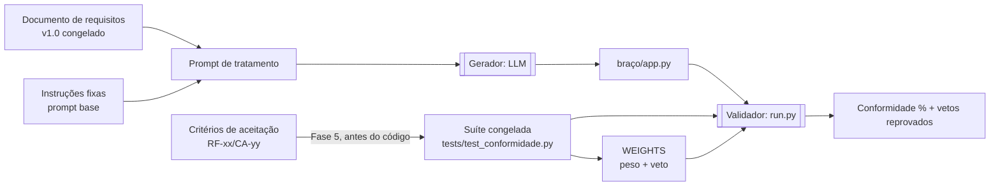

# Agente de Geração e Validação

Este documento descreve o agente que o grupo construiu para validar o processo de requisitos (pasta `entrega_grupo/4_evidencias`): o que ele recebe, o que ele produz, como mede a conformidade e como está organizado em arquivos. A seção 9 mostra como adaptá-lo para os microsserviços de Produtos e Fornecimentos.

---

## 1. Visão geral

O "agente" não é uma LLM sozinha. São dois papéis separados de propósito:

| Papel | Quem executa | Entrada | Saída | Pode ver os testes? |
|---|---|---|---|---|
| **Gerador** | LLM (Claude, Gemini, Perplexity...) | Prompt de instruções + documento de requisitos congelado | Código (`app.py`) | **Não** |
| **Validador** | Código determinístico (pytest + `run.py`) | Código gerado + suíte congelada + mapa de pesos | Conformidade ponderada + lista de vetos reprovados | Sim, é dono deles |

A separação vem da Fase 5 do processo: os testes são escritos **antes** da geração (test-first) e a LLM nunca escreve nem avalia os próprios testes. Assim a medição não vira autoavaliação.



---

## 2. Estrutura de diretórios

```
4_evidencias/
├── run.py                     # Validador: roda a suíte em cada braço e calcula a conformidade
├── spec/
│   └── prompts.py             # Entradas do Gerador: CONTROL_PROMPT e TREATMENT_PROMPT
├── tests/
│   ├── __init__.py
│   └── test_conformidade.py   # Suíte congelada + mapa WEIGHTS {teste: (peso, veto)}
├── control/                   # Braço controle (prosa livre)
│   ├── __init__.py
│   └── app.py
├── treatment/                 # Braço tratamento, gerado pelo Claude Sonnet
│   ├── __init__.py
│   └── app.py
├── perplexity/                # Braço tratamento, gerado pelo Perplexity
│   ├── __init__.py
│   └── app.py
└── gemini/                    # Braço tratamento, gerado pelo Gemini 3 Pro
    ├── __init__.py
    └── app.py
```

Cada braço é um pacote Python com um único `app.py`. O validador escolhe o braço pela variável de ambiente `APP_MODULE` (ex.: `gemini.app`), então adicionar um modelo novo é só criar a pasta e registrar no `run.py`.

---

## 3. Formato de entrada do Gerador

O gerador recebe um único texto. Existem dois formatos, um por braço.

### 3.1 Braço controle (prosa livre)

Pedido em linguagem natural, sem requisitos estruturados. Serve de linha de base.

```text
Faça uma API em Python com FastAPI para controle de despesas pessoais.
Deve ter cadastro de usuário, login, e permitir cadastrar e listar despesas, além de um total.
Coloque tudo em um único arquivo. Responda apenas com o código Python, sem explicações e sem markdown.
```

### 3.2 Braço tratamento (documento estruturado)

O prompt tem dois blocos: **A** é fixo entre execuções (variável de controle do experimento) e **B** é o documento de requisitos congelado.

**Bloco A: instruções fixas**

```text
Você é um engenheiro de software responsável por implementar os requisitos abaixo.
Use o documento como única fonte de verdade.

Instruções:
1. Implemente somente os requisitos identificados.
2. Respeite regras de negócio, contratos de entrada/saída e critérios de aceitação.
3. Não invente comportamentos não definidos.
4. Preserve as restrições de segurança e escopo.
5. Entregue TUDO em um único arquivo Python, com uma variável de módulo `app` (instância FastAPI).
6. Responda APENAS com o código Python, sem explicações e sem cercas markdown.
NÃO gere testes — eles já existem e estão congelados.
```

**Bloco B: documento congelado, nesta ordem de seções**

```markdown
# Documento de Requisitos — <Sistema> (v<X.Y>, congelado)

## Stack obrigatória
- <linguagem + framework>. <persistência>. Instância exposta como `app`.

## Contratos
<MÉTODO> <caminho>  (autenticado?) entrada {<campos>} -> <status> {<campos de saída>} (<restrição, ex.: NUNCA retorne a senha>)

## Requisitos funcionais e critérios de aceitação
- RF-xx/CA-yy (<Alta|Média|Baixa>[, VETO/<classe>]): <comportamento observável com status HTTP e efeito em dados>.

## Requisitos não funcionais
- RNF-xx/CA-yy (<prioridade>[, VETO/<classe>]): <condição verificável>.

## Guardrails
- Never: <o que nunca fazer>.
- Always: <o que sempre fazer>.
```

Regras de formato do bloco B:

1. **Um critério por linha, com ID próprio** (`RF-01/CA-02`). O critério, e não o requisito, é a unidade de medição.
2. **Prioridade e veto ficam na própria linha**, para a LLM saber o que não pode falhar. Classes de veto: autorização, IDOR, privacidade, integridade, regra financeira.
3. **Resultado observável**: status HTTP, campos da resposta e o que é ou não persistido ("a despesa NÃO é persistida").
4. **Guardrails `Never`** repetem os vetos em forma de proibição. No piloto, as três falhas do controle (endpoint sem autenticação, IDOR, senha na resposta) eram exatamente itens `Never` do tratamento.
5. Nada que esteja **Pendente** entra no bloco B. Item pendente fica fora do escopo congelado e não conta na conformidade.

### 3.3 Diferenças entre o prompt usado e o prompt base do processo

O prompt base da Fase 6 (`1_processo`) e o `TREATMENT_PROMPT` efetivamente usado não são idênticos:

| Ponto | Prompt base (Fase 6) | Prompt usado (`spec/prompts.py`) |
|---|---|---|
| Ambiguidade | "PARE e liste perguntas objetivas antes de implementar" | Ausente |
| Relatório final | "Liste os IDs implementados e os não implementados" | Ausente; pede só código |
| Formato de saída | Livre | Um arquivo, variável `app`, sem markdown |
| Escopo por chamada | Módulos de 3 a 5 requisitos | Sistema inteiro numa chamada |

As diferenças fazem sentido para uma geração de uma só passada, avaliada automaticamente. Para o microsserviço, que tem pendências reais, a instrução "PARE e pergunte" volta a ser necessária (ver 9.4).

---

## 4. Formato de saída do Gerador

| Item | Exigência |
|---|---|
| Arquivo | `<braço>/app.py`, acompanhado de `<braço>/__init__.py` vazio |
| Ponto de entrada | Variável de módulo `app` (instância FastAPI) |
| Conteúdo | Só código Python, sem cercas markdown e sem testes |
| Estado | Em memória no módulo; o validador recarrega o módulo a cada teste |
| Alterações permitidas após a geração | Só correções de transcrição (indentação perdida, lista truncada). Nenhuma mudança de lógica, e toda correção é declarada no relatório |

---

## 5. Validador

### 5.1 Suíte congelada (`tests/test_conformidade.py`)

**Seleção do braço e isolamento**

```python
APP_MODULE = os.environ.get("APP_MODULE", "treatment.app")

@pytest.fixture()
def client():
    mod = importlib.import_module(APP_MODULE)
    importlib.reload(mod)          # zera o estado em memória entre testes
    return TestClient(mod.app)
```

**Convenção de cada teste**

```python
def test_RF01_CA02_valor_zero_rejeitado(client):
    """RF-01/CA-02 (Alta, peso 3): valor <= 0 é rejeitado, nada é persistido."""
    ...
```

- Nome: `test_<REQ>_<CA>_<descricao_curta>`, ligando o teste ao critério.
- Docstring: `<ID> (<prioridade>, peso <n>[, VETO/<classe>]): <cenário>`.
- Um teste por critério. O teste verifica a resposta **e** o efeito colateral (ex.: lista vazia depois de uma rejeição).
- Tolerância a variações que o documento não fixa: aceita `401` ou `403` sem token, `200` ou `201` na criação, lista pura ou `{"items": [...]}`.

**Mapa de pesos e veto**, no fim do arquivo, lido pelo runner:

```python
WEIGHTS = {
    "test_RF01_CA01_cadastro_valido":           (3, False),
    "test_RF01_CA02_valor_zero_rejeitado":      (3, False),
    "test_RF01_CA03_nao_autenticado_bloqueado": (3, True),
    "test_RF02_CA01_lista_somente_do_usuario":  (3, False),
    "test_RF02_CA02_isolamento_entre_usuarios": (3, True),
    "test_RF03_CA01_total_do_periodo":          (2, False),
    "test_RNF01_CA01_senha_nao_exposta":        (3, True),
    "test_RNF02_CA01_email_invalido_rejeitado": (2, False),
}
```

Pesos por prioridade: **Alta = 3, Média = 2, Baixa = 1**. O piloto usou 8 critérios, soma de pesos 22, 3 vetos.

### 5.2 Runner (`run.py`)

Para cada braço (`control`, `treatment_claude`, `perplexity`, `gemini`):

1. Roda `pytest tests/test_conformidade.py -rA` com `APP_MODULE=<braço>.app`.
2. Lê as linhas `PASSED ...::<teste>` e `FAILED ...::<teste>` do relatório e monta `{teste: aprovado?}`. Teste ausente conta como reprovado.
3. Calcula a conformidade ponderada e a lista de vetos reprovados.
4. Imprime um JSON com todos os braços.

```
                    Σ (peso dos critérios aprovados)
Conformidade (%) = ────────────────────────────────── × 100
                    Σ (peso de todos os critérios)
```

**Regra de veto:** se qualquer critério com `veto=True` reprovar, a alegação de conformidade ≥ 85% é inválida, seja qual for o percentual.

**Formato da saída**

```json
{
  "control": {
    "conformidade": 36.4,
    "veto_fail": [
      "test_RF01_CA03_nao_autenticado_bloqueado",
      "test_RF02_CA02_isolamento_entre_usuarios",
      "test_RNF01_CA01_senha_nao_exposta"
    ],
    "detail": [["test_RF01_CA01_cadastro_valido", 3, false, true], "..."]
  },
  "treatment_claude": { "conformidade": 100.0, "veto_fail": [], "detail": ["..."] }
}
```

Cada item de `detail` é `[teste, peso, veto, aprovado]`.

---

## 6. Resultado reproduzido

Executado em 2026-10-22 sobre o commit `5e36ed2`, Python 3.14, venv isolado com `fastapi`, `httpx` e `pytest`:

| Braço | Conformidade | Vetos reprovados | Meta ≥ 85% |
|---|---:|---|:--:|
| Controle (prosa livre) | 36,4% | RF-01/CA-03, RF-02/CA-02, RNF-01/CA-01 | Não |
| Tratamento, Claude Sonnet | 100,0% | nenhum | Sim |
| Tratamento, Perplexity | 100,0% | nenhum | Sim |
| Tratamento, Gemini 3 Pro | 100,0% | nenhum | Sim |

Os números batem com o relatório do experimento (`3_relatorio_tecnico`).

```bash
pip install fastapi httpx pytest
```

```bash
cd entrega_grupo/4_evidencias && python run.py
```

---

## 7. Regras de operação do agente

1. **Test-first.** A suíte é derivada dos critérios e congelada antes de qualquer geração, de preferência por um integrante diferente de quem escreve o prompt.
2. **Congelamento.** Documento, prompt e suíte têm a mesma versão. Nada muda depois de ver o código; teste errado vira *falha de teste* e nova versão.
3. **A LLM não gera nem avalia testes.**
4. **Repetição.** Cada versão roda ≥ 3 vezes por modelo, com média ± desvio-padrão.
5. **Classificação de cada falha:** ambiguidade, regra incompleta, contrato incompleto (estas três justificam mudar o documento), falha de implementação (ruído da LLM), falha de teste, mudança de escopo.
6. **Pendências fora.** Critério que depende de pendência não entra no escopo congelado nem no cálculo.

---

## 8. Limitações do agente atual

Observadas na leitura do código e na execução:

| # | Limitação | Impacto | Correção sugerida |
|---|---|---|---|
| L1 | `run.py` faz uma primeira chamada ao pytest com `--json-report`, que exige o plugin `pytest-json-report`, e descarta o resultado | Dobra o tempo de execução; sem o plugin a chamada falha em silêncio | Remover a primeira chamada |
| L2 | Uma execução por modelo; o runner não repete nem calcula desvio | Não atende à regra 4 da seção 7 | Parâmetro `--runs N` com média ± desvio |
| L3 | A suíte aceita `401` **ou** `403` sem token | Para o microsserviço, RNF-01/RNF-02 exigem exatamente `401` e RNF-03 exige `403` | Asserções estritas na suíte nova |
| L4 | Gerador numa única chamada, sem "PARE e pergunte" | Num domínio com pendências, a LLM decide em silêncio | Bloco A da seção 9.4 |
| L5 | Domínio sem concorrência, sem banco e sem mensageria | Não exercita reserva atômica, idempotência nem eventos | Dublês de teste (seção 9.1) |
| L6 | O mapa `WEIGHTS` é mantido à mão, separado das docstrings | Pode divergir do documento | Gerar o mapa a partir da docstring ou de um marcador `@pytest.mark.ca(...)` |
| L7 | Aviso de depreciação do `httpx` no `starlette.testclient` | Nenhum hoje | Fixar versões em `requirements.txt` |

---

## 9. Adaptação para Produtos e Fornecimentos

O piloto validou o método num domínio pequeno. Para os microsserviços, o formato se mantém e mudam o conteúdo do bloco B, a suíte e os dublês de teste.

### 9.1 Correspondência piloto → microsserviço

| Elemento | Piloto | Microsserviço | Status |
|---|---|---|---|
| Stack | Python + FastAPI | A definir | Pendente ([issue #10](https://github.com/davicalvarenga/Sistema-MicServ-SD/issues/10)) |
| Persistência | dict em memória | Banco próprio por serviço (RNF-05) | Tecnologia pendente ([issue #8](https://github.com/davicalvarenga/Sistema-MicServ-SD/issues/8)) |
| Autenticação | Token emitido pelo próprio app | Token do grupo de autenticação; empresa e perfil ativo no token | Pendente (P-04, [issue #2](https://github.com/davicalvarenga/Sistema-MicServ-SD/issues/2)) |
| Mensageria | Nenhuma | Kafka: publica `produto_*`, `fornecimento_criado`, `estoque_atualizado` | Envelope e tópicos pendentes (P-08, P-17, [issue #3](https://github.com/davicalvarenga/Sistema-MicServ-SD/issues/3)) |
| Como a suíte vê eventos | Não se aplica | O código publica por uma interface (`EventPublisher`); a suíte injeta um publicador em memória e confere tópico, chave e conteúdo | Proposta deste documento |
| Como a suíte gera tokens | Login no app | Fixture que emite tokens de teste com perfil e validade controlados | Proposta, depende de P-04 |
| Braços | 1 serviço | Um app por serviço: `produtos/app.py` e `fornecimentos/app.py` | Proposta |

O contrato `EventPublisher` precisa entrar no bloco B (seção "Contratos"), senão a LLM escolhe outra forma de publicar e a suíte não consegue observar os eventos. Esse é o tipo de falha que o processo classifica como *contrato incompleto*.

### 9.2 Escopo da primeira medição

Pela análise SWEBOK do repositório (seção 7.4), 6 dos 14 critérios do Documento de Requisitos v0.3 podem ser congelados hoje. Os pesos abaixo são proposta e precisam passar pela auditoria de granularidade da Fase 4.

| Critério | Requisitos | Cenário | Prioridade | Peso | Veto |
|---|---|---|---|---:|---|
| CA-01 | RNF-01 | Sem token → 401, nenhum dado | Alta | 3 | Sim (autorização) |
| CA-02 | RNF-02 | Token expirado → 401, nenhum dado | Alta | 3 | Sim (autorização) |
| CA-06 | RF-09, RF-12 | Fornecedor cria fornecimento → 201 e `fornecimento_criado` com o id como chave | Alta | 3 | Não |
| CA-09 | UC-01 A1, UC-02 A1 | Token expirado no cadastro → nada gravado, nada publicado | Alta | 3 | Sim (integridade) |
| CA-13 | RNF-03, RN-02 | Transportadora tenta criar fornecimento → 403, nada gravado nem publicado | Alta | 3 | Sim (autorização) |
| CA-14 | RF-10 | Comprador consulta fornecimentos → 200 com a quantidade disponível | Alta | 3 | Não |
| **Total** | | | | **18** | **4 vetos** |

Ressalva sobre o CA-06: para congelá-lo, o bloco B precisa fixar os campos de entrada (preço, quantidade, origem) mesmo com P-05 e P-15 em aberto. A alternativa é registrar uma decisão provisória (`DEC-xx`) com status Proposta.

Segunda onda, liberada conforme as pendências forem resolvidas:

| Critérios | Dependem de |
|---|---|
| CA-03 | P-06 (atributos obrigatórios do produto) |
| CA-04, CA-05 | Confirmação de RF-07, RF-08 e permissões (P-07, P-09) |
| CA-07, CA-08 | Confirmação de RNF-06 e RNF-09 (Propostos) |
| CA-10, CA-11, CA-12 | Contrato de `pedido_criado` e `pedido_atualizado` (P-02, P-23) e pedido acima do disponível (P-16) |

### 9.3 Estrutura proposta

```
agente-microsservico/
├── run.py                        # runner com --runs N, média ± desvio (corrige L1, L2)
├── requirements.txt              # versões fixadas (corrige L7)
├── spec/
│   ├── documento-congelado-v1.0.md   # bloco B
│   ├── instrucoes.md                 # bloco A
│   └── modulos.md                    # divisão em módulos de 3 a 5 requisitos
├── tests/
│   ├── conftest.py               # fixtures: tokens de teste, publicador em memória, app por serviço
│   ├── test_produtos.py
│   ├── test_fornecimentos.py
│   └── weights.py                # WEIGHTS {teste: (peso, veto)}
└── bracos/
    ├── controle/{produtos,fornecimentos}/app.py
    ├── claude/{produtos,fornecimentos}/app.py
    ├── gemini/{produtos,fornecimentos}/app.py
    └── perplexity/{produtos,fornecimentos}/app.py
```

### 9.4 Esqueleto do prompt para o microsserviço

**Bloco A**

```text
Você é um engenheiro de software responsável por implementar os requisitos abaixo.
Use o documento como única fonte de verdade.

Instruções:
1. Implemente somente os requisitos do módulo indicado.
2. Respeite regras de negócio, contratos de entrada/saída, contrato de eventos e critérios de aceitação.
3. Não invente comportamentos não definidos.
4. Se encontrar ambiguidade ou um item marcado "Ask First", PARE e liste perguntas objetivas antes de implementar.
5. Publique eventos SOMENTE pela interface EventPublisher descrita em "Contratos".
6. Preserve as restrições de segurança e escopo.
7. Entregue um arquivo por serviço, com a variável de módulo `app`.
8. Ao final, liste os IDs implementados e os não implementados.
NÃO gere testes — eles já existem e estão congelados.
```

**Bloco B (estrutura, sem decisões que ainda estão pendentes)**

```markdown
# Documento de Requisitos — Produtos e Fornecimentos (v1.0, congelado)

## Stack obrigatória
- <definida na issue #10>. Um app por serviço. Banco próprio por serviço (RNF-05).

## Contratos
### Autenticação
- Header `Authorization: Bearer <token>`; o token traz empresa_id, perfil_ativo e exp.
- Sem token, token inválido ou expirado → 401. Perfil sem permissão → 403.

### Eventos
- interface EventPublisher: publish(topico: str, chave: str, payload: dict) -> None
- O payload NUNCA contém o token (RNF-09). Leva apenas empresa_id e usuario_id.
- fornecimento_criado: chave = id do fornecimento.

### REST: Fornecimentos
POST /fornecimentos  (perfil fornecedor) {produto_id, preco, quantidade, origem} -> 201 {id, ...}
GET  /fornecimentos  (comprador ou fornecedor) -> 200 [{id, produto_id, preco, origem, quantidade_disponivel}]

## Requisitos funcionais e critérios de aceitação
- RNF-01/CA-01 (Alta, VETO/autorização): qualquer endpoint sem token → 401, sem dados no corpo.
- RNF-02/CA-02 (Alta, VETO/autorização): token expirado → 401, sem dados no corpo.
- RF-09/CA-06 (Alta): fornecedor cria fornecimento válido → 201; publica fornecimento_criado com o id como chave.
- UC-02/CA-09 (Alta, VETO/integridade): cadastro com token expirado não grava e não publica.
- RNF-03/CA-13 (Alta, VETO/autorização): perfil ativo transportadora em POST /fornecimentos → 403; não grava e não publica.
- RF-10/CA-14 (Alta): comprador em GET /fornecimentos → 200; cada item traz quantidade_disponivel.

## Guardrails
- Always: exigir token em todos os endpoints; usar o id da entidade como chave da mensagem.
- Ask First: exclusão lógica ou física (P-09); pedido acima do disponível (P-16); formato do preço (P-15).
- Never: colocar token em evento; gravar ou publicar quando a requisição é recusada; acessar o banco do outro serviço.
```

### 9.5 Módulos de geração (Fase 6)

| Módulo | Requisitos | Critérios |
|---|---|---|
| M1 Autenticação e autorização | RNF-01, RNF-02, RNF-03 | CA-01, CA-02, CA-09, CA-13 |
| M2 Fornecimentos: cadastro e consulta | RF-09, RF-10, RF-12, RN-01, RN-02 | CA-06, CA-14 |
| M3 Produtos: CRUD e eventos | RF-01 a RF-04, RF-06 a RF-08 | CA-03 a CA-05 (segunda onda) |
| M4 Estoque por eventos de pedido | RF-13, RF-14, RF-15, RF-19, RF-20, RNF-06, RNF-14 | CA-07, CA-10 a CA-12 (segunda onda) |

### 9.6 Checklist antes de rodar o agente

- [ ] Stack definida ([issue #10](https://github.com/davicalvarenga/Sistema-MicServ-SD/issues/10)) e registrada como ADR-016.
- [ ] Contrato de token definido ou decisão provisória registrada (P-04).
- [ ] Contrato `EventPublisher` e payload de `fornecimento_criado` fixados no bloco B.
- [ ] Prioridade, peso e veto em cada critério congelado.
- [ ] Suíte escrita e congelada antes da geração, por quem não escreve o prompt.
- [ ] Runner com ≥ 3 execuções por modelo.
- [ ] Braço controle (prosa livre) preparado para comparação.
- [ ] Versão do documento, do prompt e da suíte anotada no relatório.

---

## Referências no repositório

| Arquivo | Conteúdo usado aqui |
|---|---|
| `entrega_grupo/1_processo/01_processo_analise_requisitos.md` | Fases 4 a 8, prompt base, fórmula e veto |
| `entrega_grupo/2_artefato_instrucoes/02_modelo_e_instrucoes.md` | Modelo do documento de requisitos |
| `entrega_grupo/3_relatorio_tecnico/04_relatorio_experimento_executado.md` | Resultados do piloto |
| `entrega_grupo/4_evidencias/` | Código do agente (seções 2 a 6) |
| `docs/documento-de-requisitos.md` (v0.3) | Requisitos e critérios do microsserviço |
| `docs/analise-requisitos/analise-requisitos.html` | Critérios congeláveis (seção 7.4) |
| `docs/relatorio-tecnico.md` | ADRs e endpoints propostos |
