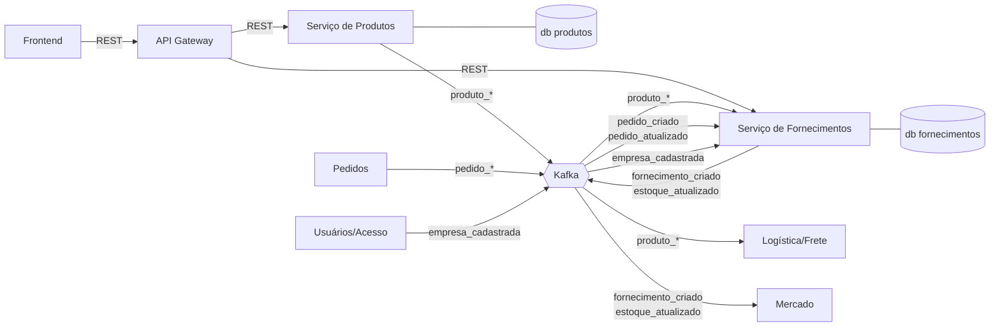
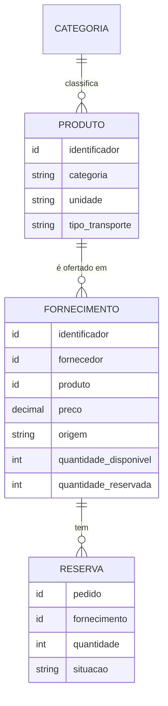
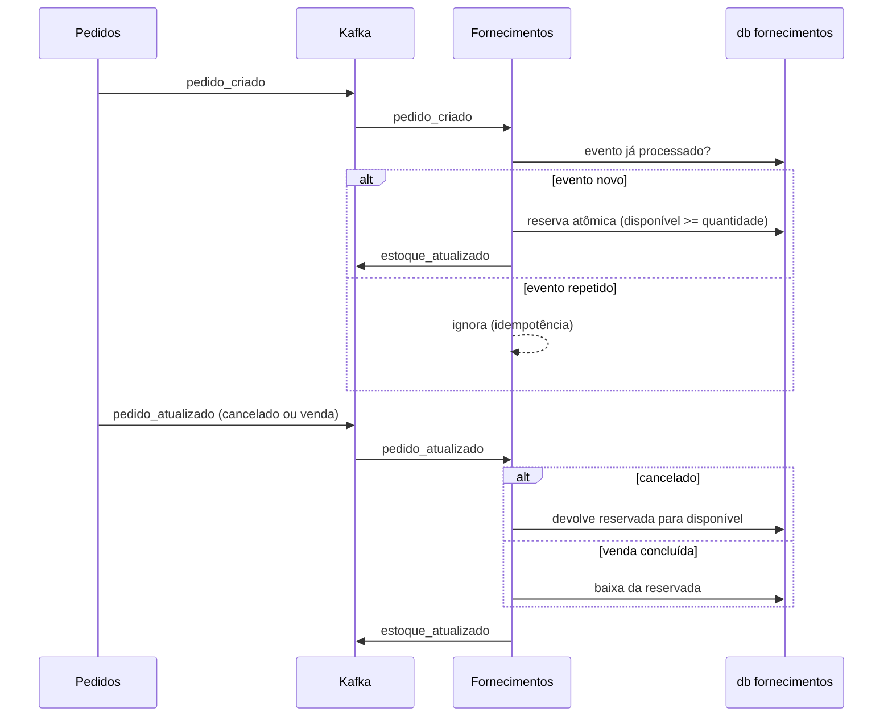

# Relatório Técnico

**Grupo:** Fornecimento e Produtos
**Sistema:** Portal B2B Distribuído (disciplina de Sistemas Distribuídos)
**Integrantes:** Daniel Carvalho Coutinho, Davi Coelho de Alvarenga, Gabriel Vicentte dos Santos Ferreira, Rafael de Castro Noleto
**Versão:** 0.1 (esboço)
**Data:** 09/10/2026

---

## Como ler e manter este relatório

Este relatório documenta o que foi implementado nos serviços do grupo, cada decisão tomada e a justificativa de cada uma. O professor vai comparar o relatório com a implementação, então ele segue três regras:

1. **Toda decisão tem status.** Aceita (já vale e está ou será implementada), Proposta (sugerida pelo grupo, ainda não validada) ou Pendente (depende de resposta externa, com a issue correspondente).
2. **Toda decisão aceita aponta onde está no código.** O campo "Evidência na implementação" recebe o caminho do arquivo, o nome do tópico ou da tabela. Uma decisão sem evidência ainda não foi implementada.
3. **O que não foi feito é declarado.** A seção 13 lista as limitações conhecidas, e a seção 14 registra onde a implementação diverge do planejado e por quê.

Os requisitos citados (RF, RNF, RN, CA) estão no [Documento de Requisitos](documento-de-requisitos.md). As decisões em aberto estão nas [issues do repositório](https://github.com/davicalvarenga/Sistema-MicServ-SD/issues).

---

## 1. Introdução

### 1.1 Objetivo

Descrever a arquitetura, a implementação e as decisões técnicas dos serviços de Produtos e de Fornecimentos do Portal B2B Distribuído.

### 1.2 Escopo

O grupo implementa dois microsserviços, correspondentes aos blocos 2 e 3 do diagrama de arquitetura do professor:

| Serviço | Responsabilidades |
|---|---|
| Produtos | Cadastro de produtos, categoria, unidade e tipo de transporte |
| Fornecimentos | Relação de fornecimento entre fornecedor e produto, preço, quantidade, origem e controle de estoque (quantidade disponível e reservada) |

O grupo se integra por eventos Kafka com os serviços de Usuários/Acesso, Mercado, Negociação/Leilão, Pedidos e Logística/Frete. Esses serviços são de outros grupos e estão fora do escopo deste relatório. O escopo detalhado está na seção 1.2 do Documento de Requisitos.

---

## 2. Contexto do sistema

### 2.1 O Portal B2B

O portal conecta empresas compradoras, fornecedoras e transportadoras. Uma empresa pode ter os três perfis ao mesmo tempo. O fluxo principal do negócio, segundo o diagrama do professor, é:

1. O fornecedor publica um fornecimento. **(nosso serviço)**
2. O comprador registra uma demanda.
3. Os eventos são publicados no Kafka. **(nossos serviços publicam e consomem)**
4. O motor de matching de Mercado compara oferta e demanda.
5. O modo de negociação é definido (venda direta, leilão direto ou reverso).
6. A negociação ocorre e o vencedor é definido.
7. O pedido é criado. **(nosso serviço reserva o estoque)**
8. A logística é acionada para o frete. **(Logística usa o tipo de transporte do produto)**
9. As transportadoras enviam cotações.
10. O frete é selecionado e a entrega é realizada.

### 2.2 Papel do grupo no fluxo

> **A preencher:** um parágrafo por passo em que o grupo atua (1, 3, 7 e 8), dizendo qual serviço participa, qual evento é publicado ou consumido e qual requisito é atendido.

---

## 3. Arquitetura dos serviços

### 3.1 Visão geral

Os nomes dos eventos seguem o diagrama do professor. Ainda não está definido se são nomes de tópicos ou tipos de evento ([issue #3](https://github.com/davicalvarenga/Sistema-MicServ-SD/issues/3)).

### 3.2 Responsabilidades de cada serviço

> **A preencher:** para cada serviço, a lista de responsabilidades, os endpoints que expõe, os eventos que publica e consome e o banco que usa. Referência: ADR-001.

### 3.3 Stack tecnológico

| Item | Escolha | Justificativa | Status |
|---|---|---|---|
| Linguagem e framework | A definir | | Pendente (ADR-016, [issue #10](https://github.com/davicalvarenga/Sistema-MicServ-SD/issues/10)) |
| Banco de dados | A definir | | Pendente (ADR-003, [issue #8](https://github.com/davicalvarenga/Sistema-MicServ-SD/issues/8)) |
| Cliente Kafka | A definir | | Pendente ([issue #10](https://github.com/davicalvarenga/Sistema-MicServ-SD/issues/10)) |
| Contêineres | Docker | Exigência do professor (aula 2, 21:48) | Aceita |

---

## 4. Modelo de domínio

### 4.1 Entidades

Este modelo é preliminar. Os atributos obrigatórios do produto, o significado de "origem" e o formato do preço dependem das issues [#4](https://github.com/davicalvarenga/Sistema-MicServ-SD/issues/4) e [#5](https://github.com/davicalvarenga/Sistema-MicServ-SD/issues/5). A entidade RESERVA é uma proposta do grupo: registrar cada reserva por pedido permite liberar ou dar baixa na quantidade certa quando chega o cancelamento ou a conclusão da venda (ADR-005).

### 4.2 Estados do estoque

| Operação | Gatilho | Quantidade disponível | Quantidade reservada | Requisito |
|---|---|---|---|---|
| Reserva | Pedido criado | diminui | aumenta | RF-14 |
| Liberação | Pedido cancelado | aumenta | diminui | RF-19, RN-06 |
| Baixa | Venda concluída | não muda | diminui | RF-20, RN-07 |

---

## 5. API REST

> **A preencher:** a tabela final de endpoints, com método, caminho, perfil exigido, corpo, respostas e códigos de status.

Proposta inicial do grupo, a confirmar durante a implementação:

| Método | Caminho | Perfil exigido | Requisito | Status |
|---|---|---|---|---|
| POST | `/produtos` | Fornecedor ou comprador | RF-01, RN-08 | Proposto |
| GET | `/produtos`, `/produtos/{id}` | Autenticado | RF-02 | Proposto |
| PUT | `/produtos/{id}` | A definir ([issue #6](https://github.com/davicalvarenga/Sistema-MicServ-SD/issues/6)) | RF-03 | Proposto |
| DELETE | `/produtos/{id}` | A definir ([issue #6](https://github.com/davicalvarenga/Sistema-MicServ-SD/issues/6)) | RF-04 | Proposto |
| GET, POST | `/categorias` | A definir ([issue #4](https://github.com/davicalvarenga/Sistema-MicServ-SD/issues/4)) | RF-05 | Pendente |
| POST | `/fornecimentos` | Fornecedor | RF-09, RN-02 | Proposto |
| GET | `/fornecimentos`, `/fornecimentos/{id}` | Comprador ou fornecedor | RF-10 | Proposto |

Códigos de erro comuns a todos os endpoints: 400 (dados inválidos), 401 (token ausente, inválido ou expirado), 403 (perfil sem permissão), 404 (recurso inexistente), 422 (referência a produto inexistente no cadastro de fornecimento).

---

## 6. Integração via Kafka

### 6.1 Eventos publicados e consumidos

| Evento | Serviço | Papel | Chave | Status |
|---|---|---|---|---|
| `produto_cadastrado` | Produtos | Publica | id do produto | Aceita (diagrama) |
| `produto_atualizado` | Produtos | Publica | id do produto | Proposta (ADR-013) |
| `produto_excluido` | Produtos | Publica | id do produto | Proposta (ADR-013) |
| `produto_*` | Fornecimentos | Consome | id do produto | Proposta (ADR-011) |
| `fornecimento_criado` | Fornecimentos | Publica | id do fornecimento | Aceita (diagrama) |
| `estoque_atualizado` | Fornecimentos | Publica | id do fornecimento | Aceita (diagrama) |
| `pedido_criado`, `pedido_atualizado` | Fornecimentos | Consome | definida por Pedidos | Pendente ([issue #1](https://github.com/davicalvarenga/Sistema-MicServ-SD/issues/1)) |
| `empresa_cadastrada` | Fornecimentos | Consome | definida por Usuários/Acesso | Pendente ([issue #2](https://github.com/davicalvarenga/Sistema-MicServ-SD/issues/2)) |

> **A preencher:** nome final de cada tópico, número de partições, formato de cada evento (campos e exemplo) e grupo de consumidores de cada serviço.

### 6.2 Fluxo de reserva de estoque

### 6.3 Garantias de entrega

Referências: ADR-007, ADR-008, ADR-009 e ADR-019.

> **A preencher:** configuração final do produtor e do consumidor (acks, idempotência, commit de offset, número de tentativas) e onde ela está no código.

---

## 7. Segurança

Referências: ADR-012 e ADR-018. Requisitos: RNF-01, RNF-02, RNF-03, RNF-09.

| Situação | Resposta do serviço |
|---|---|
| Requisição sem token | 401 |
| Token expirado ou inválido | 401 |
| Token válido, perfil sem permissão | 403 |

> **A preencher:** como o token é validado (no gateway, no serviço ou nos dois), de onde vêm a empresa e o perfil ativo, e onde essa verificação está no código. Depende da [issue #2](https://github.com/davicalvarenga/Sistema-MicServ-SD/issues/2).

---

## 8. Persistência e consistência

Referências: ADR-003, ADR-004, ADR-006, ADR-010.

> **A preencher:** tecnologia de banco, esquema das tabelas, como a reserva atômica foi implementada e como banco e Kafka são mantidos consistentes.

---

## 9. Tratamento de falhas

| Falha | Tratamento | Referência |
|---|---|---|
| Evento recebido duas vezes | Ignorado pela verificação de evento processado | ADR-007, RNF-06 |
| Evento com formato inválido | Enviado ao tópico de erro após as tentativas | ADR-019, RNF-10 |
| Pedidos simultâneos para o mesmo fornecimento | Reserva atômica, sem ultrapassar a quantidade disponível | ADR-006, RNF-14 |
| Pedido maior que o disponível | A definir ([issue #1](https://github.com/davicalvarenga/Sistema-MicServ-SD/issues/1)) | P-16 |
| Kafka indisponível no momento da publicação | Depende de ADR-010 | ADR-010 |

---

## 10. Implantação

Docker é obrigatório (aula 2, 21:48 a 21:58).

> **A preencher:** Dockerfile de cada serviço, arquivo de composição para rodar localmente, variáveis de ambiente e como o ambiente do grupo de infra é usado.

---

## 11. Testes e validação

Os critérios de aceitação CA-01 a CA-14 do Documento de Requisitos são a base dos testes.

> **A preencher:** tipos de teste executados (unidade, integração com banco e Kafka, ponta a ponta), ferramentas usadas, resultado de cada critério de aceitação e como rodar os testes.

| Critério | Teste que o cobre | Resultado |
|---|---|---|
| CA-01 a CA-14 | A preencher | A preencher |

---

## 12. Registro de decisões (ADRs)

Formato de cada decisão, baseado em Michael Nygard, *Documenting Architecture Decisions* (2011), com um campo extra de evidência:

- **Contexto:** o problema e os dados que motivam a decisão
- **Decisão:** o que foi escolhido
- **Alternativas consideradas**
- **Consequências:** o que melhora e o que piora
- **Evidência na implementação:** onde a decisão aparece no código
- **Status:** Aceita, Proposta ou Pendente

### Índice

| ADR | Decisão | Status |
|---|---|---|
| 001 | Dois microsserviços: Produtos e Fornecimentos | Aceita |
| 002 | Comunicação entre módulos por eventos Kafka | Aceita |
| 003 | Banco próprio para cada serviço | Aceita (tecnologia pendente) |
| 004 | Estoque controlado por fornecimento, com quantidade disponível e reservada | Proposta |
| 005 | Reserva de estoque como Saga coreografada com compensação | Proposta |
| 006 | Reserva atômica por atualização condicional | Proposta |
| 007 | Idempotência por registro de eventos processados | Proposta |
| 008 | Identificador da entidade como chave das mensagens | Proposta |
| 009 | Produtor com `acks=all` e idempotência habilitada | Proposta |
| 010 | Consistência entre banco e Kafka | Pendente |
| 011 | Fornecimentos mantém cópia local dos produtos a partir dos eventos | Proposta |
| 012 | Validação do token de acesso | Pendente |
| 013 | Nomes dos eventos de alteração e exclusão de produto | Proposta |
| 014 | Exclusão de produto lógica ou física | Pendente |
| 015 | Serialização e envelope dos eventos | Pendente |
| 016 | Linguagem e framework | Pendente |
| 017 | Implementação das telas do módulo | Pendente |
| 018 | Eventos não carregam token de acesso | Proposta |
| 019 | Tópico de erro para mensagens que falham no processamento | Proposta |

---

### ADR-001: Dois microsserviços, Produtos e Fornecimentos

- **Contexto:** o diagrama do professor separa Produtos (bloco 2) e Fornecimentos (bloco 3), cada um com o seu banco.
- **Decisão:** implementar dois serviços independentes, seguindo o diagrama.
- **Alternativas consideradas:** um único serviço com os dois domínios. Seria mais simples de implementar, mas diverge da arquitetura definida pelo professor.
- **Consequências:** cada serviço pode evoluir e ser implantado separadamente. A relação entre fornecimento e produto passa a cruzar serviços, o que exige o ADR-011.
- **Evidência na implementação:** a preencher
- **Status:** Aceita (decisão do grupo de seguir o diagrama)

### ADR-002: Comunicação entre módulos por eventos Kafka

- **Contexto:** a turma definiu o Kafka como meio de comunicação entre os microsserviços, e o diagrama mostra todos os módulos ligados ao Kafka. Na aula 2 (1:07) há uma menção a não usar RabbitMQ, mas a transcrição desse trecho é incerta.
- **Decisão:** toda comunicação com módulos de outros grupos acontece por eventos Kafka. REST fica restrito a Frontend, API Gateway e serviço.
- **Consequências:** os serviços ficam desacoplados no tempo, porque um pode estar fora do ar sem bloquear o outro. Em troca, a consistência entre serviços passa a ser eventual, e o tratamento de duplicidade e de ordem fica a cargo de cada serviço (ADR-007 e ADR-008).
- **Evidência na implementação:** a preencher
- **Status:** Aceita (definição da turma e do professor)

### ADR-003: Banco próprio para cada serviço

- **Contexto:** a legenda do diagrama indica "banco de dados próprio de cada serviço". O padrão é conhecido como *Database per service* (microservices.io).
- **Decisão:** Produtos e Fornecimentos têm bancos separados, e nenhum outro serviço os acessa diretamente.
- **Consequências:** um serviço não quebra quando o outro muda o esquema. Em troca, consultas que juntam dados dos dois serviços precisam de cópia local (ADR-011).
- **Pendência:** tecnologia do banco e papel do grupo de banco de dados ([issue #8](https://github.com/davicalvarenga/Sistema-MicServ-SD/issues/8)).
- **Evidência na implementação:** a preencher
- **Status:** Aceita (tecnologia pendente)

### ADR-004: Estoque controlado por fornecimento

- **Contexto:** vários fornecedores podem ofertar o mesmo produto, cada um com o seu preço (aula 1, 16:04). O evento `estoque_atualizado` sai do bloco Fornecimentos no diagrama. O professor descreve o estoque com uma parte disponível e uma parte bloqueada por pedidos (aula 1, 8:13 a 9:42).
- **Decisão:** cada fornecimento tem a sua quantidade disponível e a sua quantidade reservada.
- **Alternativas consideradas:** estoque único por produto. Não permite saber de qual fornecedor sai a quantidade de um pedido.
- **Consequências:** o pedido precisa identificar o fornecimento, não só o produto ([issue #1](https://github.com/davicalvarenga/Sistema-MicServ-SD/issues/1)).
- **Evidência na implementação:** a preencher
- **Status:** Proposta ([issue #5](https://github.com/davicalvarenga/Sistema-MicServ-SD/issues/5))

### ADR-005: Reserva de estoque como Saga coreografada com compensação

- **Contexto:** criar um pedido e reservar o estoque são operações em serviços e bancos diferentes, então não cabem em uma única transação de banco. O professor chama a operação de transação e pede que o cancelamento devolva a quantidade (aula 1, 9:18 a 9:42).
- **Decisão:** usar o padrão Saga (microservices.io; Garcia-Molina e Salem, 1987) na forma coreografada. Cada serviço reage aos eventos do outro: `pedido_criado` provoca a reserva, o cancelamento provoca a liberação (ação de compensação) e a venda concluída provoca a baixa.
- **Alternativas consideradas:** Saga orquestrada, com um coordenador central que comanda cada passo. Facilita acompanhar o fluxo, mas exige um componente a mais e um dono para ele. Com só dois participantes (Pedidos e Fornecimentos), a coreografia é suficiente.
- **Consequências:** existe um intervalo em que o pedido já existe e a reserva ainda não foi feita. Se a reserva falhar, Pedidos precisa ser avisado, o que depende da resposta da [issue #1](https://github.com/davicalvarenga/Sistema-MicServ-SD/issues/1).
- **Evidência na implementação:** a preencher
- **Status:** Proposta

### ADR-006: Reserva atômica por atualização condicional

- **Contexto:** o professor cita o caso de 30 compradores querendo o mesmo produto na mesma hora (aula 1, 14:40). Se duas reservas lerem o mesmo saldo e gravarem em seguida, as duas podem ser aceitas e o estoque fica negativo. Os eventos de pedido devem usar o id do pedido como chave, então pedidos diferentes para o mesmo fornecimento podem ser processados ao mesmo tempo por instâncias diferentes do consumidor.
- **Decisão:** fazer a reserva com uma única instrução de atualização que só tem efeito se houver saldo, por exemplo: `UPDATE fornecimento SET disponivel = disponivel - :q, reservado = reservado + :q WHERE id = :id AND disponivel >= :q`. Se nenhuma linha for alterada, a reserva é recusada.
- **Alternativas consideradas:**
  - Bloqueio pessimista (`SELECT ... FOR UPDATE` seguido de `UPDATE`): correto, mas mantém a linha bloqueada por mais tempo e exige duas instruções.
  - Controle otimista com coluna de versão: evita bloqueio, mas obriga a repetir a operação quando há conflito, o que é frequente justamente no cenário de alta disputa citado pelo professor.
- **Justificativa:** em bancos relacionais, uma instrução `UPDATE` é atômica e bloqueia a linha alterada. No PostgreSQL, no nível de isolamento padrão (Read Committed), uma segunda atualização concorrente espera a primeira terminar e reavalia a condição `WHERE` sobre a versão nova da linha (documentação do PostgreSQL, seção *Transaction Isolation*). Assim, a segunda reserva vê o saldo já reduzido. O comportamento precisa ser confirmado no banco que for escolhido.
- **Evidência na implementação:** a preencher
- **Status:** Proposta ([issue #10](https://github.com/davicalvarenga/Sistema-MicServ-SD/issues/10))

### ADR-007: Idempotência por registro de eventos processados

- **Contexto:** o Kafka entrega uma mensagem de novo se o consumidor falhar depois de processar e antes de registrar o offset (documentação do Apache Kafka, seção *Message Delivery Semantics*). Sem proteção, uma mesma reserva seria aplicada duas vezes.
- **Decisão:** gravar o identificador de cada evento consumido em uma tabela com chave única, na mesma transação da alteração de estoque. Se o identificador já existir, o evento é ignorado.
- **Consequências:** exige que todo evento tenha um identificador único, o que precisa entrar no contrato de eventos ([issue #3](https://github.com/davicalvarenga/Sistema-MicServ-SD/issues/3)).
- **Evidência na implementação:** a preencher
- **Status:** Proposta

### ADR-008: Identificador da entidade como chave das mensagens

- **Contexto:** o Kafka só garante ordem dentro de uma partição, e mensagens com a mesma chave vão para a mesma partição (documentação do Apache Kafka).
- **Decisão:** eventos de produto usam o id do produto como chave. Eventos de fornecimento e de estoque usam o id do fornecimento.
- **Consequências:** os eventos de uma mesma entidade chegam na ordem em que foram publicados, desde que estejam no mesmo tópico (ver ADR-013 e [issue #3](https://github.com/davicalvarenga/Sistema-MicServ-SD/issues/3)).
- **Evidência na implementação:** a preencher
- **Status:** Proposta

### ADR-009: Produtor com `acks=all` e idempotência habilitada

- **Contexto:** desde o Kafka 3.0 (KIP-679), esses são os valores padrão do produtor Java. Um defeito impediu que fossem aplicados nas versões 3.0.0 e 3.1.0, corrigido em 3.0.1, 3.1.1 e 3.2.0 (notas de atualização do Apache Kafka, KAFKA-13598).
- **Decisão:** configurar `acks=all` e `enable.idempotence=true` de forma explícita.
- **Consequências:** evita mensagens perdidas por falha de um broker e duplicatas causadas por novas tentativas do produtor, independentemente da versão e do cliente usados.
- **Evidência na implementação:** a preencher
- **Status:** Proposta

### ADR-010: Consistência entre banco e Kafka

- **Contexto:** gravar no banco e publicar no Kafka são duas operações separadas. Se a gravação funcionar e a publicação falhar, os outros serviços ficam sem saber da mudança.
- **Alternativas:**
  - Padrão *Transactional Outbox* (microservices.io): o evento é gravado em uma tabela do próprio banco, na mesma transação, e um processo separado o publica no Kafka. Resolve o problema, mas exige uma tabela e um publicador a mais.
  - Publicação logo após a gravação: mais simples, com o risco de perder o evento em caso de falha. O risco precisa constar na seção 13.
- **Decisão:** a tomar, junto com a tecnologia do banco.
- **Evidência na implementação:** a preencher
- **Status:** Pendente ([issue #10](https://github.com/davicalvarenga/Sistema-MicServ-SD/issues/10))

### ADR-011: Fornecimentos mantém cópia local dos produtos

- **Contexto:** o serviço de Fornecimentos precisa saber se um produto existe (RN-03), mas não pode acessar o banco de Produtos (ADR-003). As orientações de Kafka pedem que o módulo consuma eventos de produto.
- **Decisão:** Fornecimentos consome `produto_cadastrado`, `produto_atualizado` e `produto_excluido` e mantém uma tabela local com os produtos válidos.
- **Alternativas consideradas:** consultar o serviço de Produtos por REST a cada novo fornecimento. Cria dependência síncrona, o que contraria o ADR-002.
- **Consequências:** a cópia local pode ficar alguns instantes atrasada em relação ao serviço de Produtos (consistência eventual).
- **Evidência na implementação:** a preencher
- **Status:** Proposta

### ADR-012: Validação do token de acesso

- **Contexto:** todos os endpoints exigem autenticação, e o token expirado precisa ser recusado (exigência do professor). O diagrama mostra o API Gateway fazendo a autenticação, com JWT/OAuth2.
- **Alternativas:**
  - Validação local do JWT com a chave pública do emissor (RFC 7517): não faz chamada de rede por requisição, mas um token revogado continua válido até expirar.
  - Introspecção no serviço de autenticação (RFC 7662): revogação imediata, mas uma chamada por requisição.
  - Confiar no gateway: simplifica o serviço, mas depende da rede interna ser confiável.
- **Decisão:** a tomar com o grupo de autenticação.
- **Evidência na implementação:** a preencher
- **Status:** Pendente ([issue #2](https://github.com/davicalvarenga/Sistema-MicServ-SD/issues/2))

### ADR-013: Nomes dos eventos de alteração e exclusão de produto

- **Contexto:** o diagrama mostra apenas `produto_cadastrado`, e as orientações de Kafka exigem eventos de alteração e exclusão.
- **Decisão:** usar `produto_atualizado` e `produto_excluido`, no mesmo padrão do diagrama (minúsculas, entidade seguida do verbo no particípio).
- **Pendência:** se forem tópicos separados, a ordem entre cadastro e alteração não é garantida (ADR-008). Depende da [issue #3](https://github.com/davicalvarenga/Sistema-MicServ-SD/issues/3).
- **Evidência na implementação:** a preencher
- **Status:** Proposta

### ADR-014: Exclusão de produto lógica ou física

- **Contexto:** a exclusão de um produto com fornecimentos ativos ou pedidos em andamento não está definida.
- **Alternativas:** exclusão lógica (o produto é marcado como inativo e o histórico continua consultável) ou exclusão física (o registro é apagado).
- **Decisão:** a tomar.
- **Evidência na implementação:** a preencher
- **Status:** Pendente ([issue #6](https://github.com/davicalvarenga/Sistema-MicServ-SD/issues/6))

### ADR-015: Serialização e envelope dos eventos

- **Contexto:** todos os grupos precisam ler os eventos uns dos outros. O diagrama cita Schema Registry.
- **Alternativas:** JSON (simples, legível, sem infraestrutura extra), Avro ou Protobuf com Schema Registry (validação forte de esquema). Para o envelope, a especificação CloudEvents (CNCF) define campos padrão como `id`, `source`, `type` e `time`.
- **Decisão:** a tomar com o grupo de infra e a turma.
- **Evidência na implementação:** a preencher
- **Status:** Pendente ([issue #3](https://github.com/davicalvarenga/Sistema-MicServ-SD/issues/3))

### ADR-016: Linguagem e framework

- **Contexto:** a linguagem é livre (aula 2, 21:45).
- **Decisão:** a tomar.
- **Evidência na implementação:** a preencher
- **Status:** Pendente ([issue #10](https://github.com/davicalvarenga/Sistema-MicServ-SD/issues/10))

### ADR-017: Implementação das telas do módulo

- **Contexto:** o professor sugere que cada grupo faça o próprio frontend (aula 2, 21:45) e exige modo escuro, acessibilidade e responsividade, seguindo o padrão da equipe de UX.
- **Decisão:** a tomar.
- **Evidência na implementação:** a preencher
- **Status:** Pendente ([issue #9](https://github.com/davicalvarenga/Sistema-MicServ-SD/issues/9))

### ADR-018: Eventos não carregam token de acesso

- **Contexto:** o token é temporário, e o evento fica guardado no Kafka durante todo o período de retenção.
- **Decisão:** os eventos levam apenas o identificador da empresa e do usuário que executou a ação, nunca o token.
- **Consequências:** o consumidor não pode usar o token do evento para chamar outros serviços em nome do usuário. Também não há credencial exposta no Kafka.
- **Evidência na implementação:** a preencher
- **Status:** Proposta

### ADR-019: Tópico de erro para mensagens que falham

- **Contexto:** uma mensagem com formato inválido, se não for tratada, faz o consumidor tentar processá-la para sempre e trava as mensagens seguintes da mesma partição.
- **Decisão:** depois de esgotadas as tentativas, a mensagem vai para um tópico de erro, e o consumo continua. O Apache Kafka não oferece esse recurso para consumidores comuns (ele existe apenas no Kafka Connect), então o envio ao tópico de erro é feito pelo próprio serviço.
- **Evidência na implementação:** a preencher
- **Status:** Proposta

---

## 13. Limitações conhecidas e itens não implementados

> **A preencher ao longo do projeto.** Cada item diz o que não foi feito, por que e qual o impacto.

| Item | Motivo | Impacto |
|---|---|---|
| | | |

---

## 14. Divergências entre o planejado e o implementado

> **A preencher ao longo do projeto.** Sempre que a implementação se afastar de um requisito ou de um ADR, registre aqui.

| Requisito ou ADR | Planejado | Implementado | Justificativa |
|---|---|---|---|
| | | | |

---

## 15. Referências

- Documento de Requisitos do grupo: [documento-de-requisitos.md](documento-de-requisitos.md)
- Diagrama "Arquitetura do Portal B2B Distribuído", elaborado pelo professor
- NYGARD, Michael. Documenting Architecture Decisions, 2011: https://cognitect.com/blog/2011/11/15/documenting-architecture-decisions
- Apache Kafka, documentação oficial: https://kafka.apache.org/documentation/
- KIP-679, Producer will enable the strongest delivery guarantee by default: https://cwiki.apache.org/confluence/display/KAFKA/KIP-679%3A+Producer+will+enable+the+strongest+delivery+guarantee+by+default
- Apache Kafka, notas de atualização: https://kafka.apache.org/31/getting-started/upgrade/
- KLEPPMANN, Martin. Should you put several event types in the same Kafka topic?, 2018: https://martin.kleppmann.com/2018/01/18/event-types-in-kafka-topic.html
- RICHARDSON, Chris. Pattern: Database per service: https://microservices.io/patterns/data/database-per-service.html
- RICHARDSON, Chris. Pattern: Saga: https://microservices.io/patterns/data/saga.html
- RICHARDSON, Chris. Pattern: Transactional outbox: https://microservices.io/patterns/data/transactional-outbox.html
- GARCIA-MOLINA, Hector; SALEM, Kenneth. Sagas. ACM SIGMOD, 1987.
- PostgreSQL, documentação, Transaction Isolation: https://www.postgresql.org/docs/current/transaction-iso.html
- CloudEvents, especificação: https://github.com/cloudevents/spec
- RFC 6750, Bearer Token Usage: https://datatracker.ietf.org/doc/html/rfc6750
- RFC 7517, JSON Web Key: https://datatracker.ietf.org/doc/html/rfc7517
- RFC 7662, OAuth 2.0 Token Introspection: https://datatracker.ietf.org/doc/html/rfc7662

---

## Histórico de revisões

| Versão | Data | Descrição |
|---|---|---|
| 0.1 | 09/10/2026 | Esboço inicial com estrutura, diagramas e registro de 19 decisões (aceitas, propostas e pendentes) |
