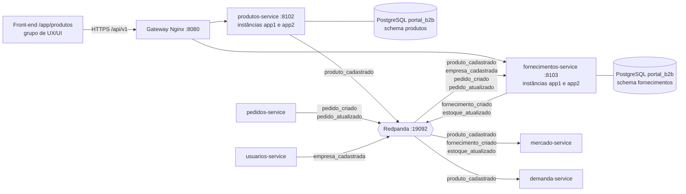
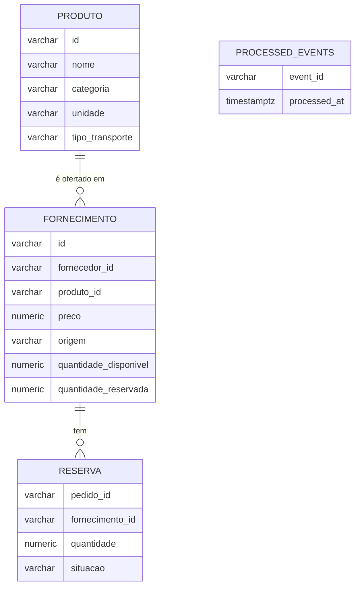
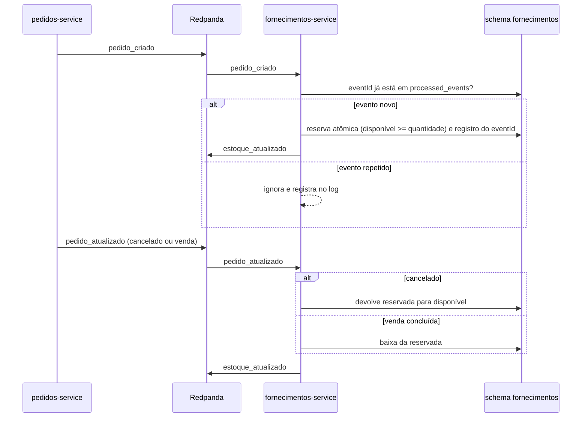

# Relatório Técnico

**Grupo:** Fornecimento e Produtos
**Sistema:** Portal B2B Distribuído (disciplina de Sistemas Distribuídos)
**Integrantes:** Daniel Carvalho Coutinho, Davi Coelho de Alvarenga, Gabriel Vicentte dos Santos Ferreira, Rafael de Castro Noleto
**Versão:** 0.3 (esboço)
**Data:** 26/10/2026

---

## Como ler e manter este relatório

Este relatório documenta o que foi implementado nos serviços do grupo, cada decisão tomada e a justificativa de cada uma. O professor vai comparar o relatório com a implementação, então ele segue três regras:

1. **Toda decisão tem status.** Aceita (já vale e está ou será implementada), Proposta (sugerida pelo grupo, ainda não validada) ou Pendente (depende de resposta externa, com a issue ou a pendência correspondente).
2. **Toda decisão aceita aponta onde está no código.** O campo "Evidência na implementação" recebe o caminho do arquivo, o nome do tópico ou da tabela. Uma decisão sem evidência ainda não foi implementada.
3. **O que não foi feito é declarado.** A seção 13 lista as limitações conhecidas, e a seção 14 registra onde a implementação diverge do planejado e por quê.

Os requisitos citados (RF, RNF, RN, CA) e as pendências (P) estão no [Documento de Requisitos](documento-de-requisitos.md) versão 0.4. As especificações por serviço, no modelo do Grupo de Teste, estão em [`especificacoes/`](especificacoes/): elas definem as portas (`EventBus`, `Clock` e repositório) pelas quais o código acessa banco e Kafka. As decisões em aberto estão nas [issues do repositório](https://github.com/davicalvarenga/Sistema-MicServ-SD/issues).

---

## 1. Introdução

### 1.1 Objetivo

Descrever a arquitetura, a implementação e as decisões técnicas dos serviços de Produtos e de Fornecimentos do Portal B2B Distribuído.

### 1.2 Escopo

O grupo implementa dois microsserviços, correspondentes aos blocos 2 e 3 do diagrama de arquitetura do professor:

| Serviço | Porta local | Schema no banco | Responsabilidades |
|---|---|---|---|
| `produtos-service` | 8102 | `produtos` | Cadastro de produtos, categoria, unidade e tipo de transporte |
| `fornecimentos-service` | 8103 | `fornecimentos` | Relação de fornecimento entre fornecedor e produto, preço, quantidade, origem e controle de estoque (quantidade disponível e reservada) |

As portas e os schemas foram definidos pelo grupo de Infraestrutura no kit de integração da turma (repositório `Printf-PedroCardoso/portal-b2b-kit-infra`, commit `630515c`, chamado neste relatório de "kit").

O grupo se integra por eventos com os serviços dos grupos de Autenticação, Compra e Demanda, Mercado, Negociação/Leilão e Pedidos, e Logística/Transporte. Esses serviços, os front-ends (grupo de UX/UI), o banco (grupo de Banco de Dados) e a plataforma (grupo de Infraestrutura) estão fora do escopo deste relatório.

---

## 2. Contexto do sistema

### 2.1 O Portal B2B

O portal conecta empresas compradoras, fornecedoras e transportadoras. O fluxo principal do negócio, segundo o diagrama do professor, é:

1. O fornecedor publica um fornecimento. **(nosso serviço)**
2. O comprador registra uma demanda.
3. Os eventos são publicados no Kafka. **(nossos serviços publicam e consomem)**
4. O motor de matching de Mercado compara oferta e demanda.
5. O modo de negociação é definido (venda direta, leilão direto ou reverso).
6. A negociação ocorre e o vencedor é definido.
7. O pedido é criado. **(nosso serviço reserva o estoque)**
8. A logística é acionada para o frete. **(Logística usa o tipo de transporte do produto)**
9. As transportadoras enviam cotações.
10. O frete é selecionado e a entrega é realizada.

### 2.2 Papel do grupo no fluxo

> **A preencher:** um parágrafo por passo em que o grupo atua (1, 3, 7 e 8), dizendo qual serviço participa, qual evento é publicado ou consumido e qual requisito é atendido.

---

## 3. Arquitetura dos serviços

### 3.1 Visão geral

O gateway distribui as requisições entre as duas instâncias de cada serviço. O Redpanda é compatível com a API do Apache Kafka, então os conceitos e as bibliotecas do Kafka valem para ele. Os tópicos de alteração e exclusão de produto ainda não existem no kit (P-26), e por isso não aparecem no diagrama.

### 3.2 Responsabilidades de cada serviço

> **A preencher:** para cada serviço, a lista de responsabilidades, os endpoints que expõe, os eventos que publica e consome e as tabelas que usa. Referência: ADR-001.

### 3.3 Stack tecnológico

| Item | Escolha | Justificativa | Status |
|---|---|---|---|
| Linguagem e framework | Python 3.12 com FastAPI | É a base do kit: boilerplate, Dockerfile e biblioteca comum de autenticação, erros, eventos e logs. Usar a mesma base dos outros grupos reduz o risco de integração | Proposta (ADR-016) |
| Banco de dados | PostgreSQL 16, banco `portal_b2b`, schemas `produtos` e `fornecimentos` | Definido pelo kit | Aceita (ADR-003) |
| Mensageria | Redpanda com 3 brokers, compatível com a API do Kafka | Definido pelo kit | Aceita (ADR-002) |
| Cliente Kafka | `aiokafka` | É o cliente usado pela biblioteca comum do kit. Precisa ser incluído no `requirements.txt` dos serviços (seção 3.4) | Proposta |
| Acesso ao banco | `psycopg2`, com pool de até 5 conexões por instância | Biblioteca comum do kit, RNF-23 | Aceita |
| Contêineres | Docker | Exigência do professor (aula 2, 21:48) e base do kit | Aceita |
| Observabilidade | Prometheus, Grafana, Loki e Jaeger | Definido pelo kit | Aceita |

### 3.4 Análise do kit de infraestrutura

O grupo analisou o kit antes de usá-lo como base. A tabela registra o que foi encontrado, como cada ponto foi verificado e o que o grupo vai fazer. "Análise estática" significa que o ponto foi identificado lendo o código, sem executá-lo.

| # | Ponto encontrado | Como foi verificado | Impacto para o grupo | Encaminhamento |
|---|---|---|---|---|
| K1 | No script do banco (`database/01-init.sql`), as permissões dos usuários `svc_*` são concedidas antes da criação das tabelas. No PostgreSQL, `GRANT ... ON ALL TABLES IN SCHEMA` vale só para tabelas que já existem | **Teste executado** em PostgreSQL 16 local com o script do kit: `svc_fornecimentos` recebeu `permission denied for table fornecimento` | Os serviços não conseguem ler nem gravar nas próprias tabelas | Levar ao grupo de Infraestrutura e de Banco de Dados (P-32) com a correção testada: conceder `SELECT, INSERT, UPDATE, DELETE` depois do `CREATE TABLE` e usar `ALTER DEFAULT PRIVILEGES FOR ROLE portal_ddl` para tabelas futuras |
| K2 | Os contêineres dos serviços não recebem `DB_USER` nem `DB_PASSWORD` no `docker-compose.yml`, e `services/common/db.py` usa `portal_admin` (superusuário) por padrão | Análise estática | Contraria o guia do próprio kit (seção 5.2) e o RNF-24 | Configurar `DB_USER=svc_produtos` e `DB_USER=svc_fornecimentos` nos nossos serviços. Avisar a Infraestrutura (P-32) |
| K3 | Nenhum `requirements.txt` do kit instala cliente Kafka. `services/common/events.py` importa `aiokafka` dentro de um `try` que captura qualquer exceção e só registra um aviso | Análise estática | Os eventos não chegam ao Redpanda, e a falha aparece apenas como aviso no log | Incluir `aiokafka` nas dependências. Avisar a Infraestrutura |
| K4 | O `docker-compose.yml` monta cada serviço com o contexto de build na pasta do próprio serviço, mas o `main.py` importa o pacote `common`, que fica em `services/common`, fora desse contexto | Análise estática | Dentro do contêiner, a importação de `common` tende a falhar na inicialização | Ajustar o contexto de build ou copiar `common` para a imagem. Avisar a Infraestrutura |
| K5 | `services/common/consumer.py` e `services/common/idempotency.py` guardam os eventos processados e as chaves de idempotência em memória, apesar de a tabela `processed_events` existir | Análise estática | Perde a idempotência ao reiniciar e entre as instâncias `app1` e `app2` | Registrar o `eventId` na tabela `processed_events`, na mesma transação da alteração (ADR-007) |
| K6 | `services/common/events.py` cria e encerra um produtor Kafka a cada evento e, se a publicação falhar, guarda o evento numa lista em memória e segue | Análise estática | Latência maior em cada escrita (RNF-25) e perda silenciosa de eventos | Manter um produtor por processo e tratar a falha de publicação (ADR-010) |
| K7 | O boilerplate de `fornecimentos-service` só verifica o perfil se o cabeçalho de autorização vier na requisição, recebe o `fornecedor_id` no corpo e guarda os dados em dicionários na memória | Análise estática | Sem token, qualquer um cria fornecimento, em nome de qualquer fornecedor | Exigir autenticação em todas as rotas (RNF-01), tirar o fornecedor do token (RN-10) e persistir no banco (RNF-26) |
| K8 | Em `services/common/auth.py`, `require_roles` executa `"admin" not in user_role`. Se o token não tiver `perfil`, a operação falha com erro de tipo e o serviço responde 500 | Análise estática | Token sem perfil gera 500 em vez de 403 | Tratar perfil ausente como 403 no nosso código |
| K9 | `services/common/errors.py` não inclui `timestamp` no corpo do erro, e os erros de validação do FastAPI (422) usam o formato padrão do framework, não a RFC 7807 | Análise estática | Contraria o RNF-20 | Incluir `timestamp` e registrar um tratador para os erros de validação |
| K10 | Os boilerplates respondem `/health/ready` sem testar banco e Redpanda, e `/metrics` devolve um número fixo | Análise estática | Contraria o RNF-22 | Implementar as verificações e as métricas reais |
| K11 | O guia, o `CONTRACTS.md`, o script de tópicos e o código divergem em nomes de tópico, chaves, campo de versão do envelope e nome do claim da empresa | Comparação dos arquivos | Risco de cada grupo seguir um arquivo diferente | Seguir o que está implementado e pedir a unificação (P-33) |

---

## 4. Modelo de domínio

### 4.1 Entidades

O kit já cria as tabelas `produtos.produto`, `fornecimentos.fornecimento`, `fornecimentos.movimento_estoque` e `processed_events` nos dois schemas. Os atributos de PRODUTO e de FORNECIMENTO acima seguem essas tabelas, com uma diferença: o kit não tem `quantidade_reservada` nem a tabela RESERVA, que são propostas do grupo para atender à reserva de estoque (RF-13, ADR-005). Registrar cada reserva por pedido permite liberar ou dar baixa na quantidade certa quando chega o cancelamento ou a conclusão da venda. O DDL é do grupo de Banco de Dados (P-28).

A categoria é um texto no produto, sem tabela própria, como no kit (P-10). Preço e quantidades são `NUMERIC(12,2)`, o que permite quantidades decimais em unidades como KG e L.

### 4.2 Estados do estoque

| Operação | Gatilho | Quantidade disponível | Quantidade reservada | Requisito |
|---|---|---|---|---|
| Reserva | Pedido criado | diminui | aumenta | RF-14 |
| Liberação | Pedido cancelado | aumenta | diminui | RF-19, RN-06 |
| Baixa | Venda concluída | não muda | diminui | RF-20, RN-07 |

Nenhuma operação pode deixar a quantidade disponível negativa (RN-11).

---

## 5. API REST

> **A preencher:** a tabela final de endpoints, com método, caminho, perfil exigido, corpo, respostas e códigos de status. A documentação gerada pelo FastAPI em `/docs` serve de referência.

Proposta do grupo, seguindo o padrão do kit (ADR-020):

| Método | Caminho | Perfil exigido | Requisito | Status |
|---|---|---|---|---|
| POST | `/api/v1/produtos` | Fornecedor ou comprador | RF-01, RN-08 | Proposto (perfil comprador: P-30) |
| GET | `/api/v1/produtos?page=&size=&categoria=` | Autenticado | RF-02, RNF-21 | Proposto |
| GET | `/api/v1/produtos/{id}` | Autenticado | RF-02 | Proposto |
| PUT | `/api/v1/produtos/{id}` | A definir (P-07) | RF-03 | Proposto |
| DELETE | `/api/v1/produtos/{id}` | A definir (P-07) | RF-04 | Proposto |
| POST | `/api/v1/fornecimentos` | Fornecedor | RF-09, RN-02, RN-10 | Proposto |
| GET | `/api/v1/fornecimentos?page=&size=&produto_id=` | Comprador ou fornecedor | RF-10, RNF-21 | Proposto |
| GET | `/api/v1/fornecimentos/{id}` | Comprador ou fornecedor | RF-10 | Proposto |
| GET | `/health`, `/health/ready`, `/metrics`, `/docs`, `/openapi.json` | Sem autenticação | RNF-22 | Aceita (F8) |

Códigos de resposta de erro, sempre no formato RFC 7807 (RNF-20): 401 (token ausente, inválido ou expirado), 403 (perfil sem permissão), 404 (recurso inexistente), 422 (dados inválidos, `size` maior que 100, produto inexistente no cadastro de fornecimento ou quantidade maior que a disponível), 429 (limite de requisições do gateway) e 503 (dependência fora do ar em `/health/ready`).

O boilerplate do kit expõe `POST /api/v1/fornecimentos/{id}/baixa-estoque`. A proposta do grupo é não manter esse endpoint, porque o estoque muda pelos eventos de pedido (ADR-022).

---

## 6. Integração via Kafka

### 6.1 Eventos publicados e consumidos

| Tópico | Serviço | Papel | Chave (`aggregateId`) | Status |
|---|---|---|---|---|
| `produto_cadastrado` | Produtos | Publica | `produtoId` | Aceita (F8) |
| Alteração e exclusão de produto | Produtos | Publica | `produtoId` | Pendente: o kit não tem tópico (ADR-013, P-26) |
| `produto_cadastrado` | Fornecimentos | Consome | `produtoId` | Aceita (ADR-011) |
| `fornecimento_criado` | Fornecimentos | Publica | `fornecimentoId` | Aceita (F8) |
| `estoque_atualizado` | Fornecimentos | Publica | `fornecimentoId` | Aceita (F8) |
| `empresa_cadastrada` | Fornecimentos | Consome | `empresaId` | Aceita (conteúdo: P-12) |
| `pedido_criado`, `pedido_atualizado` | Fornecimentos | Consome | `pedidoId` | Pendente (P-02, P-29) |
| `produtos.dlt`, `fornecimentos.dlt` | Produtos, Fornecimentos | Publica falhas | a do evento original | Aceita (ADR-019) |

Os tópicos de negócio têm 3 partições, fator de replicação 3 e retenção de 7 dias. Os tópicos de falha têm 1 partição e retenção de 14 dias (F8, `CONTRACTS.md` e `scripts/init_topics.sh`).

O conteúdo (`payload`) de cada evento, com JSON Schema e exemplo validado, está no [Contrato de Eventos](contrato-eventos.md).

> **A preencher:** o nome do grupo de consumidores de cada serviço.

### 6.2 Fluxo de reserva de estoque

### 6.3 Garantias de entrega

| Item | Configuração | Referência |
|---|---|---|
| Produtor | `acks=all`, `enable.idempotence=true` | ADR-009, RNF-08 |
| Chave das mensagens | `aggregateId` da entidade | ADR-008, RNF-07 |
| Consumo repetido | `eventId` registrado em `processed_events` na mesma transação | ADR-007, RNF-06 |
| Falha no processamento | 3 tentativas com espera de 1, 2 e 4 segundos, depois envio ao tópico de falha | ADR-019, RNF-10 |
| Envelope | `eventId`, `eventType`, `eventVersion`, `timestamp`, `source`, `correlationId`, `aggregateId`, `payload` | ADR-015, RNF-13 |

> **A preencher:** onde cada configuração está no código e como o commit de offset foi feito.

---

## 7. Segurança

Referências: ADR-012, ADR-018 e ADR-020. Requisitos: RNF-01, RNF-02, RNF-03, RNF-09, RNF-24.

| Situação | Resposta do serviço |
|---|---|
| Requisição sem token | 401, RFC 7807, título "Não Autenticado" |
| Token expirado | 401, RFC 7807, título "Token Expirado" |
| Token inválido | 401, RFC 7807, título "Token Inválido" |
| Token válido, perfil sem permissão | 403, RFC 7807 |

O token é um JWT assinado com HS256 e validado em cada serviço com a chave compartilhada `JWT_SECRET_KEY` (F8, `services/common/auth.py`). O access token vale 15 minutos. O serviço lê do token o usuário (`sub`), a empresa e o `perfil`.

> **A preencher:** onde a verificação está no código e a tabela final de perfis por rota.

---

## 8. Persistência e consistência

Referências: ADR-003, ADR-004, ADR-006, ADR-007, ADR-010.

- Cada serviço usa só o próprio schema, com o usuário `svc_produtos` ou `svc_fornecimentos` (RNF-24) e no máximo 5 conexões por instância (RNF-23).
- As tabelas são criadas pelo grupo de Banco de Dados com o usuário `portal_ddl`. O grupo de Fornecimento e Produtos não executa DDL.
- A reserva é feita com atualização condicional (ADR-006), na mesma transação do registro em `processed_events` (ADR-007).

A proposta de DDL enviada ao grupo de Banco de Dados está em [`banco/`](banco/README.md): `quantidade_reservada`, tabela `reserva`, tabela `produto_referencia`, tabelas `outbox`, verificações de estoque não negativo e permissões corrigidas. Ela foi testada em PostgreSQL 16, inclusive com duas reservas simultâneas (teste T11), o que confirma o comportamento do ADR-006.

> **A preencher:** o esquema final aprovado pelo grupo de Banco de Dados, o código da reserva e como banco e Kafka são mantidos consistentes.

---

## 9. Tratamento de falhas

| Falha | Tratamento | Referência |
|---|---|---|
| Evento recebido duas vezes | Ignorado pela verificação em `processed_events` | ADR-007, RNF-06 |
| Evento com formato inválido ou erro persistente | Enviado ao tópico de falha após 3 tentativas | ADR-019, RNF-10 |
| Pedidos simultâneos para o mesmo fornecimento | Reserva atômica, sem ultrapassar a quantidade disponível | ADR-006, RNF-14 |
| Pedido maior que o disponível | Reserva recusada. A forma de avisar Pedidos está em aberto | RN-11, P-16 |
| Redpanda indisponível no momento da publicação | Depende do ADR-010. A biblioteca comum do kit perde o evento em silêncio (seção 3.4, K6) | ADR-010 |
| Banco ou Redpanda fora do ar | `/health/ready` responde 503 | RNF-22 |

---

## 10. Implantação

O ambiente local segue o kit:

1. `make env` (copia `.env.example` para `.env`).
2. `make infra-up` (sobe PostgreSQL, Redpanda, gateway, PgAdmin na porta 5050, Kafka UI na porta 8090 e os front-ends).
3. Executar cada serviço com `uvicorn main:app --reload --port 8102` (Produtos) ou `--port 8103` (Fornecimentos), ou subir a pilha completa com `make up`.

> **A preencher:** variáveis de ambiente de cada serviço (incluindo `DB_USER` e `DB_PASSWORD`, seção 3.4, K2), ajustes feitos no Dockerfile e no contexto de build (K4) e evidência de execução com duas instâncias.

---

## 11. Testes e validação

Os critérios de aceitação CA-01 a CA-19 do Documento de Requisitos são a base dos testes do grupo. O Grupo de Teste roda, de forma independente, testes de contrato, carga (k6) e caos, com as metas do RNF-25. Dois testes previstos pelo Grupo de Teste cobrem diretamente o nosso serviço: comprador tentando criar fornecimento deve receber 403, e evento repetido deve ser ignorado.

> **A preencher:** tipos de teste executados pelo grupo, ferramentas, resultado de cada critério de aceitação e como rodar os testes.

| Critério | Teste que o cobre | Resultado |
|---|---|---|
| CA-01 a CA-19 | A preencher | A preencher |

---

## 12. Registro de decisões (ADRs)

Formato de cada decisão, baseado em Michael Nygard, *Documenting Architecture Decisions* (2011), com um campo extra de evidência:

- **Contexto:** o problema e os dados que motivam a decisão
- **Decisão:** o que foi escolhido
- **Alternativas consideradas**
- **Consequências:** o que melhora e o que piora
- **Evidência na implementação:** onde a decisão aparece no código
- **Status:** Aceita, Proposta ou Pendente

### Índice

| ADR | Decisão | Status |
|---|---|---|
| 001 | Dois microsserviços: Produtos e Fornecimentos | Aceita |
| 002 | Comunicação entre módulos por eventos no Redpanda (API Kafka) | Aceita |
| 003 | Um schema por serviço no PostgreSQL 16 | Aceita |
| 004 | Estoque controlado por fornecimento, com quantidade disponível e reservada | Proposta |
| 005 | Reserva de estoque como Saga coreografada com compensação | Proposta |
| 006 | Reserva atômica por atualização condicional | Proposta |
| 007 | Idempotência por registro de eventos processados no banco | Aceita |
| 008 | `aggregateId` como chave das mensagens | Aceita |
| 009 | Produtor com `acks=all` e idempotência habilitada | Aceita |
| 010 | Consistência entre banco e Kafka | Pendente |
| 011 | Fornecimentos mantém cópia local dos produtos a partir dos eventos | Aceita |
| 012 | Validação local do JWT em cada serviço | Aceita |
| 013 | Eventos de alteração e exclusão de produto | Pendente |
| 014 | Exclusão de produto lógica ou física | Pendente |
| 015 | Eventos em JSON com envelope canônico | Aceita |
| 016 | Python com FastAPI | Proposta |
| 017 | Front-ends feitos pelo grupo de UX/UI | Aceita |
| 018 | Eventos não carregam token de acesso | Proposta |
| 019 | Tópicos de falha `produtos.dlt` e `fornecimentos.dlt` | Aceita |
| 020 | Padrão de API do kit de infraestrutura | Aceita |
| 021 | Uso do kit como base, com as correções da seção 3.4 | Proposta |
| 022 | Estoque alterado só por eventos de pedido | Proposta |

---

### ADR-001: Dois microsserviços, Produtos e Fornecimentos

- **Contexto:** o diagrama do professor separa Produtos (bloco 2) e Fornecimentos (bloco 3). O kit cria um serviço e um schema para cada um.
- **Decisão:** implementar dois serviços independentes, seguindo o diagrama e o kit.
- **Alternativas consideradas:** um único serviço com os dois domínios. Seria mais simples de implementar, mas diverge da arquitetura definida pelo professor.
- **Consequências:** cada serviço pode evoluir e ser implantado separadamente. A relação entre fornecimento e produto passa a cruzar serviços, o que exige o ADR-011.
- **Evidência na implementação:** a preencher
- **Status:** Aceita

### ADR-002: Comunicação entre módulos por eventos no Redpanda

- **Contexto:** a turma definiu o Kafka como meio de comunicação entre os microsserviços. O kit usa o Redpanda, compatível com a API do Kafka, em 3 brokers com fator de replicação 3. O guia do kit proíbe chamadas síncronas entre APIs nos fluxos de negócio.
- **Decisão:** toda comunicação de negócio com outros serviços acontece por eventos. REST fica restrito a front-end, gateway e serviço.
- **Consequências:** os serviços ficam desacoplados no tempo, porque um pode estar fora do ar sem bloquear o outro. Em troca, a consistência entre serviços passa a ser eventual, e o tratamento de duplicidade e de ordem fica a cargo de cada serviço (ADR-007 e ADR-008).
- **Evidência na implementação:** a preencher
- **Status:** Aceita

### ADR-003: Um schema por serviço no PostgreSQL 16

- **Contexto:** a legenda do diagrama indica "banco de dados próprio de cada serviço". O kit implementa isso com um único servidor PostgreSQL 16, um banco `portal_b2b` e um schema por serviço, com um usuário por serviço que só acessa o próprio schema. O padrão *Database per service* (microservices.io) admite essa forma, chamada *schema per service*, ao lado de tabelas privadas por serviço e de um servidor por serviço.
- **Decisão:** usar os schemas `produtos` e `fornecimentos`, com os usuários `svc_produtos` e `svc_fornecimentos`, e no máximo 5 conexões por instância.
- **Alternativas consideradas:** um servidor de banco por serviço. Isola melhor as falhas, mas não é o que o kit oferece.
- **Consequências:** o isolamento entre serviços depende das permissões de cada usuário, que hoje estão incorretas no script do kit (seção 3.4, K1). Uma falha do servidor de banco afeta todos os serviços ao mesmo tempo.
- **Evidência na implementação:** a preencher
- **Status:** Aceita

### ADR-004: Estoque controlado por fornecimento

- **Contexto:** vários fornecedores podem ofertar o mesmo produto, cada um com o seu preço (aula 1, 16:04). O professor descreve o estoque com uma parte disponível e uma parte bloqueada por pedidos (aula 1, 8:13 a 9:42). No kit, a quantidade disponível fica na tabela `fornecimento`.
- **Decisão:** cada fornecimento tem a sua quantidade disponível e a sua quantidade reservada.
- **Alternativas consideradas:** estoque único por produto. Não permite saber de qual fornecedor sai a quantidade de um pedido.
- **Consequências:** o pedido precisa identificar o fornecimento. O exemplo de `pedido_criado` do kit traz `fornecedorId` e `produtoId`, mas não o `fornecimentoId` (P-02).
- **Evidência na implementação:** a preencher
- **Status:** Proposta ([issue #5](https://github.com/davicalvarenga/Sistema-MicServ-SD/issues/5))

### ADR-005: Reserva de estoque como Saga coreografada com compensação

- **Contexto:** criar um pedido e reservar o estoque são operações em serviços e schemas diferentes, então não cabem em uma única transação de banco. O professor chama a operação de transação e pede que o cancelamento devolva a quantidade (aula 1, 9:18 a 9:42).
- **Decisão:** usar o padrão Saga (microservices.io; Garcia-Molina e Salem, 1987) na forma coreografada. Cada serviço reage aos eventos do outro: `pedido_criado` provoca a reserva, o cancelamento provoca a liberação (ação de compensação) e a venda concluída provoca a baixa.
- **Alternativas consideradas:** Saga orquestrada, com um coordenador central que comanda cada passo. Facilita acompanhar o fluxo, mas exige um componente a mais e um dono para ele. Com só dois participantes (Pedidos e Fornecimentos), a coreografia é suficiente.
- **Consequências:** existe um intervalo em que o pedido já existe e a reserva ainda não foi feita. Se a reserva falhar, Pedidos precisa ser avisado (P-16). O momento em que o pedido é criado também muda o comportamento: se for depois da negociação fechada, como no kit, o estoque não fica bloqueado durante o leilão (P-29).
- **Evidência na implementação:** a preencher
- **Status:** Proposta ([issue #1](https://github.com/davicalvarenga/Sistema-MicServ-SD/issues/1))

### ADR-006: Reserva atômica por atualização condicional

- **Contexto:** o professor cita o caso de 30 compradores querendo o mesmo produto na mesma hora (aula 1, 14:40). Se duas reservas lerem o mesmo saldo e gravarem em seguida, as duas podem ser aceitas e o estoque fica negativo. Os eventos de pedido usam o `pedidoId` como chave, então pedidos diferentes para o mesmo fornecimento podem ser processados ao mesmo tempo por instâncias diferentes do serviço.
- **Decisão:** fazer a reserva com uma única instrução de atualização que só tem efeito se houver saldo, por exemplo: `UPDATE fornecimentos.fornecimento SET quantidade_disponivel = quantidade_disponivel - %s, quantidade_reservada = quantidade_reservada + %s WHERE id = %s AND quantidade_disponivel >= %s`. Se nenhuma linha for alterada, a reserva é recusada.
- **Alternativas consideradas:**
  - Bloqueio pessimista (`SELECT ... FOR UPDATE` seguido de `UPDATE`): correto, mas mantém a linha bloqueada por mais tempo e exige duas instruções.
  - Controle otimista com coluna de versão: evita bloqueio, mas obriga a repetir a operação quando há conflito, o que é frequente justamente no cenário de alta disputa citado pelo professor.
- **Justificativa:** o banco confirmado pelo kit é o PostgreSQL 16. No nível de isolamento padrão (Read Committed), uma segunda atualização concorrente sobre a mesma linha espera a primeira terminar e reavalia a condição `WHERE` sobre a versão nova da linha (documentação do PostgreSQL, seção *Transaction Isolation*). Assim, a segunda reserva vê o saldo já reduzido. Os parâmetros (`%s`) evitam injeção de SQL.
- **Verificação:** em 26/10/2026, duas sessões tentaram reservar 60 unidades de um fornecimento com 100, ao mesmo tempo. A segunda esperou a primeira, reavaliou a condição e não reservou nada (`UPDATE 0`). O estoque terminou com 40 disponíveis e 60 reservadas (teste T11 em [`banco/README.md`](banco/README.md)).
- **Evidência na implementação:** a preencher
- **Status:** Proposta ([issue #10](https://github.com/davicalvarenga/Sistema-MicServ-SD/issues/10))

### ADR-007: Idempotência por registro de eventos processados no banco

- **Contexto:** o Kafka entrega uma mensagem de novo se o consumidor falhar depois de processar e antes de registrar o offset (documentação do Apache Kafka, seção *Message Delivery Semantics*). O guia do kit exige a tabela `processed_events`, e o Grupo de Teste vai enviar o mesmo evento várias vezes para verificar.
- **Decisão:** gravar o `eventId` de cada evento consumido na tabela `processed_events` do próprio schema, na mesma transação da alteração de dados. Se o `eventId` já existir, o evento é ignorado e o fato é registrado no log.
- **Alternativas consideradas:** o controle em memória da biblioteca comum do kit (`services/common/consumer.py`). Foi descartado porque se perde quando o serviço reinicia e não é compartilhado entre as instâncias `app1` e `app2`.
- **Consequências:** a gravação no banco e o registro do evento são atômicos. Se o processo cair entre os dois, nenhum dos dois acontece.
- **Evidência na implementação:** a preencher
- **Status:** Aceita

### ADR-008: `aggregateId` como chave das mensagens

- **Contexto:** o Kafka só garante ordem dentro de uma partição, e mensagens com a mesma chave vão para a mesma partição (documentação do Apache Kafka). O catálogo do kit define a chave de cada tópico.
- **Decisão:** usar `produtoId` nos eventos de produto e `fornecimentoId` em `fornecimento_criado` e `estoque_atualizado`, como no `CONTRACTS.md` e no código do kit. O guia do kit cita `produto_id` para esses dois tópicos, divergência registrada na P-33.
- **Consequências:** os eventos de um mesmo fornecimento chegam na ordem em que foram publicados, dentro de cada tópico.
- **Evidência na implementação:** a preencher
- **Status:** Aceita

### ADR-009: Produtor com `acks=all` e idempotência habilitada

- **Contexto:** desde o Kafka 3.0 (KIP-679), esses são os valores padrão do produtor Java. Um defeito impediu que fossem aplicados nas versões 3.0.0 e 3.1.0, corrigido em 3.0.1, 3.1.1 e 3.2.0 (notas de atualização do Apache Kafka, KAFKA-13598). A biblioteca comum do kit já configura os dois valores.
- **Decisão:** manter `acks=all` e `enable_idempotence=True` de forma explícita.
- **Consequências:** evita mensagens perdidas por falha de um broker e duplicatas causadas por novas tentativas do produtor.
- **Evidência na implementação:** a preencher
- **Status:** Aceita

### ADR-010: Consistência entre banco e Kafka

- **Contexto:** gravar no banco e publicar no Kafka são duas operações separadas. Se a gravação funcionar e a publicação falhar, os outros serviços ficam sem saber da mudança. A biblioteca comum do kit, nesse caso, guarda o evento numa lista em memória e segue em frente (seção 3.4, K6).
- **Alternativas:**
  - Padrão *Transactional Outbox* (microservices.io): o evento é gravado numa tabela do próprio schema, na mesma transação, e um processo separado o publica no Kafka. Resolve o problema, mas exige uma tabela a mais, que depende do grupo de Banco de Dados, e um publicador.
  - Publicação logo após a gravação, devolvendo erro ao cliente se a publicação falhar: mais simples, mas ainda há uma janela em que o dado foi gravado e o evento não saiu.
- **Recomendação do grupo:** pedir a tabela de outbox ao grupo de Banco de Dados junto com o ajuste da P-28, já que o PostgreSQL está confirmado.
- **Evidência na implementação:** a preencher
- **Status:** Pendente ([issue #10](https://github.com/davicalvarenga/Sistema-MicServ-SD/issues/10))

### ADR-011: Fornecimentos mantém cópia local dos produtos

- **Contexto:** o serviço de Fornecimentos precisa saber se um produto existe (RN-03), mas não pode acessar o schema de Produtos (ADR-003). O catálogo do kit lista o `fornecimentos-service` como consumidor de `produto_cadastrado`.
- **Decisão:** Fornecimentos consome `produto_cadastrado` e mantém uma tabela local com os produtos válidos. Alteração e exclusão dependem do ADR-013.
- **Alternativas consideradas:** consultar o serviço de Produtos por REST a cada novo fornecimento. Cria dependência síncrona, o que contraria o ADR-002.
- **Consequências:** a cópia local pode ficar alguns instantes atrasada em relação ao serviço de Produtos (consistência eventual). A tabela local também depende do DDL do grupo de Banco de Dados.
- **Evidência na implementação:** a preencher
- **Status:** Aceita

### ADR-012: Validação local do JWT em cada serviço

- **Contexto:** todos os endpoints exigem autenticação, e o token expirado precisa ser recusado (exigência do professor). O kit define JWT assinado com HS256 e validado em cada serviço pela biblioteca comum, com access token de 15 minutos.
- **Decisão:** validar o token em cada requisição com a biblioteca comum do kit e responder 401 ou 403 no formato RFC 7807.
- **Alternativas que foram consideradas pela turma:** introspecção no serviço de autenticação (RFC 7662), que permite revogação imediata, mas exige uma chamada por requisição; e assinatura assimétrica (RS256), em que só o serviço de autenticação tem a chave que assina.
- **Consequências:** nenhuma chamada de rede por requisição. Como HS256 usa a mesma chave para assinar e validar, qualquer serviço que tenha `JWT_SECRET_KEY` também consegue emitir tokens válidos. Esse risco é aceito pela arquitetura da turma e fica registrado aqui. Um token só deixa de valer quando expira.
- **Evidência na implementação:** a preencher
- **Status:** Aceita

### ADR-013: Eventos de alteração e exclusão de produto

- **Contexto:** as orientações de Kafka exigem eventos de alteração e exclusão de produto. O kit só cria o tópico `produto_cadastrado`, e cada evento tem um tópico próprio.
- **Alternativas:**
  - Pedir os tópicos `produto_atualizado` e `produto_excluido`. Segue o padrão do kit, mas a ordem entre cadastro e alteração de um mesmo produto não é garantida, porque estão em tópicos diferentes. O consumidor precisaria comparar `timestamp` ou versão.
  - Publicar os três tipos de evento em um único tópico de produto, distinguidos pelo `eventType`. Garante a ordem por `produtoId` (Kleppmann, 2018), mas foge do padrão de um tópico por evento.
- **Decisão:** a tomar com o grupo de Infraestrutura.
- **Evidência na implementação:** a preencher
- **Status:** Pendente (P-26)

### ADR-014: Exclusão de produto lógica ou física

- **Contexto:** a exclusão de um produto com fornecimentos ativos ou pedidos em andamento não está definida. A tabela `produto` do kit não tem coluna de situação.
- **Alternativas:** exclusão lógica (o produto é marcado como inativo, o que exige ajuste no DDL) ou exclusão física (o registro é apagado).
- **Decisão:** a tomar.
- **Evidência na implementação:** a preencher
- **Status:** Pendente ([issue #6](https://github.com/davicalvarenga/Sistema-MicServ-SD/issues/6))

### ADR-015: Eventos em JSON com envelope canônico

- **Contexto:** todos os grupos precisam ler os eventos uns dos outros. O kit define o envelope e sobe o Schema Registry do Redpanda com compatibilidade `BACKWARD`.
- **Decisão:** publicar em JSON com os campos `eventId`, `eventType`, `eventVersion`, `timestamp`, `source`, `correlationId`, `aggregateId` e `payload`.
- **Pendência:** se o registro dos schemas no Schema Registry é obrigatório (P-08).
- **Evidência na implementação:** a preencher
- **Status:** Aceita

### ADR-016: Python com FastAPI

- **Contexto:** a linguagem é livre (aula 2, 21:45). O kit entrega boilerplates em FastAPI com Dockerfile e uma biblioteca comum de autenticação, erros, eventos e logs, e diz que os grupos podem removê-los ou alterá-los.
- **Decisão proposta:** usar Python 3.12 com FastAPI, aproveitando o boilerplate e a biblioteca comum com as correções da seção 3.4.
- **Alternativas consideradas:** outra linguagem. Exigiria reimplementar o envelope, o padrão de erros, a validação do token e os endpoints técnicos, com mais risco de divergir dos outros grupos.
- **Evidência na implementação:** a preencher
- **Status:** Proposta ([issue #10](https://github.com/davicalvarenga/Sistema-MicServ-SD/issues/10))

### ADR-017: Front-ends feitos pelo grupo de UX/UI

- **Contexto:** o professor exige modo escuro, acessibilidade e responsividade (aula 2). O guia do kit atribui os front-ends ao grupo de UX/UI, incluindo `/app/produtos` ("Catálogo e Gestão de Estoque do Fornecedor").
- **Decisão:** o grupo entrega a API e os erros no formato RFC 7807, e o grupo de UX/UI faz as telas.
- **Consequências:** o contrato da API (seção 5 e `/docs`) passa a ser a interface entre os dois grupos.
- **Evidência na implementação:** a preencher
- **Status:** Aceita

### ADR-018: Eventos não carregam token de acesso

- **Contexto:** o token é temporário, e o evento fica guardado no Redpanda por 7 dias.
- **Decisão:** os eventos levam apenas o identificador da empresa e do usuário que executou a ação, nunca o token.
- **Consequências:** o consumidor não pode usar o token do evento para chamar outros serviços em nome do usuário. Também não há credencial exposta no Redpanda.
- **Evidência na implementação:** a preencher
- **Status:** Proposta

### ADR-019: Tópicos de falha `produtos.dlt` e `fornecimentos.dlt`

- **Contexto:** uma mensagem com formato inválido, se não for tratada, faz o consumidor tentar processá-la para sempre e trava as mensagens seguintes da mesma partição. O Apache Kafka não oferece esse recurso para consumidores comuns (ele existe apenas no Kafka Connect), então o envio ao tópico de falha é feito pelo próprio serviço. O kit cria um tópico de falha por serviço.
- **Decisão:** depois de 3 tentativas com espera de 1, 2 e 4 segundos, a mensagem vai para `produtos.dlt` ou `fornecimentos.dlt`, com o evento original e o erro, e o consumo continua.
- **Evidência na implementação:** a preencher
- **Status:** Aceita

### ADR-020: Padrão de API do kit de infraestrutura

- **Contexto:** o guia do kit define um padrão comum para todas as APIs, e o Grupo de Teste vai verificar esse padrão.
- **Decisão:** rotas com prefixo `/api/v1`, erros no formato RFC 7807 com `correlationId` e `timestamp`, paginação com `page` e `size` (máximo 100), endpoints `/health`, `/health/ready`, `/metrics` e `/docs`, cabeçalho `X-Correlation-Id` repassado aos logs e aos eventos, e logs em JSON na saída padrão.
- **Consequências:** os front-ends e os testes tratam todos os serviços da mesma forma. O padrão de erros do FastAPI para validação precisa ser substituído (seção 3.4, K9).
- **Evidência na implementação:** a preencher
- **Status:** Aceita

### ADR-021: Uso do kit como base, com correções

- **Contexto:** o kit acelera o início do trabalho, mas tem os pontos da seção 3.4, alguns dos quais impedem o serviço de funcionar (K1, K3, K4) ou de atender aos requisitos (K5 a K10).
- **Decisão proposta:** partir do boilerplate e da biblioteca comum do kit, corrigir no nosso código o que é nosso (K5 a K10) e reportar ao grupo de Infraestrutura o que é da plataforma (K1 a K4, K11), com a evidência de cada ponto.
- **Alternativas consideradas:** escrever os serviços do zero, sem o kit. Daria mais controle, mas perderia a padronização com os outros grupos.
- **Evidência na implementação:** a preencher
- **Status:** Proposta

### ADR-022: Estoque alterado só por eventos de pedido

- **Contexto:** o boilerplate do kit expõe `POST /api/v1/fornecimentos/{id}/baixa-estoque`, sem autenticação. O fluxo definido pelo professor altera o estoque a partir dos pedidos (RF-14, RF-19, RF-20).
- **Decisão proposta:** não expor endpoint de baixa. Reserva, liberação e baixa acontecem só pelos eventos de pedido. Uma eventual reposição de quantidade pelo próprio fornecedor depende da P-11.
- **Consequências:** uma única porta de entrada para alterações de estoque, o que facilita garantir a atomicidade e a auditoria.
- **Evidência na implementação:** a preencher
- **Status:** Proposta

---

## 13. Limitações conhecidas e itens não implementados

> **A preencher ao longo do projeto.** Cada item diz o que não foi feito, por que e qual o impacto.

| Item | Motivo | Impacto |
|---|---|---|
| | | |

---

## 14. Divergências entre o planejado e o implementado

> **A preencher ao longo do projeto.** Sempre que a implementação se afastar de um requisito ou de um ADR, registre aqui.

| Requisito ou ADR | Planejado | Implementado | Justificativa |
|---|---|---|---|
| | | | |

---

## 15. Referências

- Documento de Requisitos do grupo: [documento-de-requisitos.md](documento-de-requisitos.md)
- Diagrama "Arquitetura do Portal B2B Distribuído", elaborado pelo professor
- Kit de integração do grupo de Infraestrutura: https://github.com/Printf-PedroCardoso/portal-b2b-kit-infra (commit `630515c`)
- NYGARD, Michael. Documenting Architecture Decisions, 2011: https://cognitect.com/blog/2011/11/15/documenting-architecture-decisions
- Apache Kafka, documentação oficial: https://kafka.apache.org/documentation/
- KIP-679, Producer will enable the strongest delivery guarantee by default: https://cwiki.apache.org/confluence/display/KAFKA/KIP-679%3A+Producer+will+enable+the+strongest+delivery+guarantee+by+default
- Apache Kafka, notas de atualização: https://kafka.apache.org/31/getting-started/upgrade/
- KLEPPMANN, Martin. Should you put several event types in the same Kafka topic?, 2018: https://martin.kleppmann.com/2018/01/18/event-types-in-kafka-topic.html
- RICHARDSON, Chris. Pattern: Database per service: https://microservices.io/patterns/data/database-per-service.html
- RICHARDSON, Chris. Pattern: Saga: https://microservices.io/patterns/data/saga.html
- RICHARDSON, Chris. Pattern: Transactional outbox: https://microservices.io/patterns/data/transactional-outbox.html
- GARCIA-MOLINA, Hector; SALEM, Kenneth. Sagas. ACM SIGMOD, 1987.
- PostgreSQL 16, Transaction Isolation: https://www.postgresql.org/docs/16/transaction-iso.html
- PostgreSQL 16, GRANT: https://www.postgresql.org/docs/16/sql-grant.html
- PostgreSQL 16, ALTER DEFAULT PRIVILEGES: https://www.postgresql.org/docs/16/sql-alterdefaultprivileges.html
- RFC 7807, Problem Details for HTTP APIs: https://datatracker.ietf.org/doc/html/rfc7807
- RFC 7519, JSON Web Token: https://datatracker.ietf.org/doc/html/rfc7519
- RFC 7662, OAuth 2.0 Token Introspection: https://datatracker.ietf.org/doc/html/rfc7662

---

## Histórico de revisões

| Versão | Data | Descrição |
|---|---|---|
| 0.1 | 09/10/2026 | Esboço inicial com estrutura, diagramas e registro de 19 decisões (aceitas, propostas e pendentes) |
| 0.3 | 26/10/2026 | Ligação com o Contrato de Eventos e com a proposta de DDL testada. Verificação do ADR-006 por teste de concorrência |
| 0.2 | 26/10/2026 | Incorporação do kit de infraestrutura: stack, portas, schemas, tópicos, chaves, envelope, padrão de API e segurança. Nova seção 3.4 com a análise do kit (11 pontos, um verificado por teste). ADR-002, 003, 007, 008, 009, 011, 012, 015, 017 e 019 passam a Aceita. Novos ADR-020, 021 e 022 |
